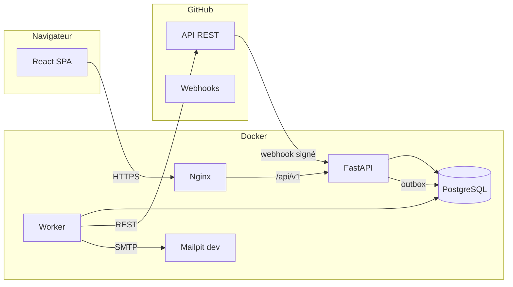

# GestActes

**Gestion des actes administratifs via GitHub**

GestActes est une application web répartie qui dématérialise le circuit d'un
acte administratif : dépôt de la demande, instruction, validation, signature,
archivage et vérification publique. Le contenu des actes est stocké dans un
dépôt GitHub privé, ce qui fournit nativement l'historique, les revues, les
branches et les tags.

Projet académique — module **Architecture logicielle et objets répartis**,
École Nationale Supérieure Polytechnique de Douala.

> **État du projet :** squelette complet et exécutable. Chaque fichier indique
> son propriétaire, son rôle et ses TODO. Les fonctionnalités sont implémentées
> progressivement par l'équipe selon `docs/repartition-taches.md`.

---

## Nouveau membre : commence ici

Si tu viens d'être invité sur le dépôt, ne commence pas par coder au hasard.

1. Lis `docs/onboarding.md` en entier (30 à 45 minutes).
2. Trouve ton nom dans `docs/repartition-taches.md`.
3. Travaille sur la branche **`develop`**, jamais sur `main`.
4. Crée une branche `feat/...` ou `fix/...`.
5. Ouvre une PR vers `develop`.
6. TSEFACK relit et fusionne. Tu ne cliques pas sur Merge.

| Membre | Première branche |
|---|---|
| TSEFACK CALVIN KLEIN | `chore/github-setup` |
| GUEMOGNE GERALDINE ESTHER | `feat/front-design-system` |
| JEUDIEU TSAGUE AUDREY DANIELLE | `feat/front-citizen-dashboard` |
| KOUODZO ZANGUE REGINA | `feat/back-auth-core` |
| LEUKAM TCHEUMALEU MAXIME | `feat/front-agent-queue` |
| METAMMO TEUMA DANIELA CLEDYA | `feat/front-validator-queue` |
| NDOUNGUE ESSOH ABEL THOMAS | `feat/back-domain-models` |
| NOLACK KAWUNJIBI FRANGE PARKER | `feat/back-github-client` |
| NZEUTEM DOMOE EUNICE FELIXTINE | `feat/front-admin-users` |
| VOUMIA OUALA DILANE | `chore/test-fixtures` |

### Ce qui est déjà fonctionnel

- Authentification : inscription, connexion, refresh, logout, profil, reset.
- Catalogue des trois types d'actes et données de démonstration.
- Administration de base : utilisateurs, audit, statistiques.
- Notifications internes, webhook GitHub signé et idempotent.
- Endpoint de comparaison pour la revue du validateur.
- Design system, toutes les routes par rôle, pages et composants.
- Docker Compose, CI, tests de base, seed.

### Ce qui reste à implémenter

- Provisioning GitHub réel : Issue, branche, commits, PR, merge, tag.
- Génération PDF et QR code en production.
- Traitement complet des webhooks et réconciliation.
- Téléchargement des pièces et du PDF depuis GitHub.
- Tests d'intégration GitHub réels et recette finale.

Le parcours métier est désormais branché : dépôt, prise en charge,
instruction, soumission, validation et signature.

Les détails, les branches et les critères de conformité sont dans
`docs/repartition-taches.md`.

---

## 1. Pourquoi GestActes

Un acte administratif partage plusieurs contraintes avec un code source :

- il doit être **historisé** : qui a modifié quoi, quand et pourquoi ;
- il doit être **relu et validé** par plusieurs personnes ;
- il doit être **protégé** par des droits précis ;
- il doit être **archivé** de manière fiable et **vérifiable**.

GitHub fournit ces mécanismes. GestActes les met au service d'un parcours
administratif simple, avec une interface adaptée à chaque rôle.

---

## 2. Fonctionnalités

### Citoyen

- Créer un compte et se connecter.
- Consulter le catalogue des types d'actes.
- Remplir un formulaire dynamique et joindre des pièces.
- Suivre l'état et l'historique de ses demandes.
- Annuler une demande non prise en charge.
- Télécharger l'acte signé au format PDF.

### Agent

- Consulter la file des demandes.
- Prendre en charge une demande.
- Rédiger et modifier le brouillon ; chaque enregistrement crée un commit.
- Demander un complément au citoyen.
- Soumettre l'acte à validation.

### Validateur

- Consulter les actes en attente.
- Comparer le contenu et les données sources.
- Approuver, demander des corrections ou rejeter avec un motif.
- Signer l'acte : empreinte SHA-256, horodatage, identité, merge de la PR.

### Administrateur

- Gérer les utilisateurs et les rôles.
- Gérer les types d'actes et leur schéma de formulaire.
- Consulter le journal d'audit.
- Visualiser les statistiques.

### Public

- Vérifier l'authenticité d'un acte par son numéro ou son QR code.
- Aucune donnée personnelle n'est exposée.

---

## 3. Architecture



**Choix structurants :**

- **API modulaire** plutôt que microservices : plus simple à livrer, frontières
  de domaines nettes.
- **Worker séparé** pour les jobs GitHub, e-mail et PDF.
- **Outbox PostgreSQL** plutôt que RabbitMQ : fiable, transactionnel, suffisant.
- **GitHub** comme source de vérité du contenu validé, signé et archivé ;
  **PostgreSQL** pour l'état du workflow, une copie de travail, l'audit et
  l'index.
- **Nginx** pour servir le front et proxifier l'API.

Détails : `docs/architecture.md` et `docs/workflow.md`.

---

## 4. Stack

| Couche | Technologies |
|---|---|
| Frontend | React 18, TypeScript, Vite, Tailwind CSS, React Router, TanStack Query, React Hook Form, Zod, `react-icons/lu` |
| Backend | Python 3.12, FastAPI, SQLModel, Pydantic v2, PostgreSQL 16 |
| Sécurité | JWT, refresh token `HttpOnly`, bcrypt, RBAC, HMAC webhook |
| GitHub | API REST, Issues, branches, Pull Requests, reviews, tags, webhooks |
| PDF | ReportLab, qrcode |
| Infra | Docker, Docker Compose, Nginx, GitHub Actions, Mailpit |
| Tests | pytest, respx, Vitest, React Testing Library |

---

## 5. Structure du projet

```text
gestactes/
  backend/
    app/
      api/routes/        routes FastAPI
      core/              configuration, sécurité, erreurs, dépendances
      models/            modèles SQLModel
      schemas/           schémas Pydantic
      services/          logique métier
      worker/            jobs asynchrones
      main.py            point d'entrée
      seed.py            données de démonstration
    tests/
    scripts/
  frontend/
    src/
      components/        design system et layout
      context/           auth et toasts
      features/          auth, public, citizen, agent, validator, admin, shared
      lib/               client API, constantes, formatage
      styles/            Tailwind
      test/
      router.tsx
    tailwind.config.ts
  docs/
    cahier-des-charges-v2.md
    revue-cdc.md
    architecture.md
    workflow.md
    api-contract.md
    design-system.md
    repartition-taches.md
    guide-contribution.md
    github-setup.md
    github-integration.md
    tests.md
    recette.md
    demo.md
  scripts/
  data/demo/
  docker-compose.yml
  .env.example
  Makefile
```

Chaque fichier commence par un en-tête indiquant :

- son **propriétaire** ;
- son **rôle** ;
- ses **TODO**.

---

## 6. Démarrage rapide

### Prérequis

- Docker et Docker Compose.
- Un token GitHub fine-grained (optionnel pour démarrer sans GitHub).
- Un dépôt privé `gestactes-data` (optionnel pour le parcours GitHub complet).

### Lancer

```bash
cp .env.example .env
# Remplacer les secrets dans .env
docker compose up --build
```

- Frontend : http://localhost:8080
- API / Swagger : http://localhost:8000/docs
- Mailpit : http://localhost:8025

### Charger les données de démonstration

```bash
docker compose exec api python -m app.seed
```

### Vérifier l'installation

```bash
./scripts/verify-setup.sh
# ou
make doctor
```

### Comptes

| Rôle | E-mail | Mot de passe |
|---|---|---|
| Citoyen | citoyen@gestactes.com | Demo1234! |
| Agent | agent@gestactes.com | Demo1234! |
| Validateur | validateur@gestactes.com | Demo1234! |
| Admin | admin@gestactes.com | Demo1234! |

---

## 7. Développement local

### Backend

```bash
cd backend
python3 -m venv .venv
source .venv/bin/activate
pip install -e ".[dev]"
uvicorn app.main:app --reload
```

### Frontend

```bash
cd frontend
npm install
npm run dev
```

Le proxy Vite redirige `/api` vers `http://localhost:8000`.

### Tests et qualité

```bash
# Backend
cd backend
.venv/bin/ruff check .
.venv/bin/mypy app
.venv/bin/pytest

# Frontend
cd frontend
npm run lint
npm run typecheck
npm run test
npm run build

# Tout
make check
```

---

## 8. Configuration GitHub

1. Créer le dépôt privé `gestactes-data`.
2. Créer un token fine-grained avec :
   - Contents : Read and write ;
   - Issues : Read and write ;
   - Pull requests : Read and write ;
   - Metadata : Read.
3. Renseigner `GITHUB_TOKEN`, `GITHUB_REPO`, `GITHUB_WEBHOOK_SECRET` dans `.env`.
4. Configurer le webhook vers `/api/v1/webhooks/github`.
5. Protéger `main` : PR obligatoire, revue, checks.

Guide complet : `docs/github-setup.md`.

En développement, simuler un webhook :

```bash
python scripts/simulate_webhook.py \
  --event pull_request \
  --delivery local-001 \
  --payload data/demo/webhook_pr_merged.json
```

---

## 9. Documentation

| Document | Contenu |
|---|---|
| `docs/cahier-des-charges-v2.md` | Cahier des charges corrigé. |
| `docs/revue-cdc.md` | Audit de la version initiale et corrections. |
| `docs/architecture.md` | Architecture, composants, décisions. |
| `docs/workflow.md` | États, transitions, rôles, effets. |
| `docs/api-contract.md` | Contrat REST gelé. |
| `docs/design-system.md` | Direction artistique et composants. |
| `docs/onboarding.md` | Parcours du premier jour et FAQ. |
| `docs/repartition-taches.md` | Propriétaires, branches, tâches. |
| `docs/guide-contribution.md` | Commandes Git et processus de PR. |
| `docs/github-setup.md` | Labels, protections, token, webhook. |
| `docs/github-integration.md` | Implémentation GitHub, worker, PDF. |
| `docs/tests.md` | Stratégie de tests. |
| `docs/recette.md` | Scénarios de recette. |
| `docs/demo.md` | Script de démonstration. |
| `docs/rapport-integration.md` | Rapport de réconciliation des travaux. |

---

## 10. Équipe

| Membre | Rôle |
|---|---|
| TSEFACK CALVIN KLEIN | Intégration, contrats, CI, releases |
| GUEMOGNE GERALDINE ESTHER | Design system, auth, public |
| JEUDIEU TSAGUE AUDREY DANIELLE | Parcours citoyen |
| KOUODZO ZANGUE REGINA | Auth back, utilisateurs, audit |
| LEUKAM TCHEUMALEU MAXIME | Parcours agent |
| METAMMO TEUMA DANIELA CLEDYA | Parcours validateur |
| NDOUNGUE ESSOH ABEL THOMAS | Actes, demandes, workflow |
| NOLACK KAWUNJIBI FRANGE PARKER | GitHub, worker, notifications, PDF |
| NZEUTEM DOMOE EUNICE FELIXTINE | Administration front, suivi projet |
| VOUMIA OUALA DILANE | Qualité, tests, seed, recette, démo |

Encadrant : **M. TCHUIGOUA CHARLU**.

---

## Inviter l'équipe sur GitHub

1. Ouvrir le dépôt GitHub.
2. **Settings → Collaborators → Add people**.
3. Ajouter chaque membre avec le rôle **Write**.
4. Ne pas donner **Admin** : seul TSEFACK administre les branches et les secrets.
5. Chaque membre accepte l'invitation, clone le dépôt et suit
   `docs/onboarding.md`.

Pendant la période de développement, il est recommandé de mettre `develop`
comme branche par défaut sur GitHub :

**Settings → General → Default branch → `develop`**.

Cela évite qu'un nouveau clone démarre sur `main`. À la release finale,
repasser la branche par défaut sur `main`.

TSEFACK doit ensuite :

- [ ] Remplacer `@TSEFACK-KLEIN` dans `.github/CODEOWNERS`.
- [ ] Protéger `main` et `develop`.
- [ ] Créer les labels avec `./scripts/setup-github.sh`.
- [ ] Créer les issues avec `./scripts/create-issues.sh`.
- [ ] Vérifier qu'un membre peut ouvrir une PR vers `develop`.
- [ ] Vérifier que la CI se déclenche sur la PR.

---

## 11. Organisation Git

Le dépôt local est déjà initialisé avec `main` et `develop`. Pour le publier :

```bash
git remote add origin git@github.com:<organisation>/gestactes.git
git push -u origin main
git push -u origin develop
```

- `main` : versions stables, uniquement alimentée par les releases.
- `develop` : intégration continue.
- `feat/*`, `fix/*`, `docs/*`, `chore/*` : branches courtes.
- PR obligatoire vers `develop`.
- TSEFACK relit et fusionne.
- Un fichier = un propriétaire.
- Aucun push direct sur `main` ou `develop`.

Détails : `docs/repartition-taches.md` et `docs/guide-contribution.md`.

---

## 12. Sécurité et limites

- Données fictives uniquement.
- Dépôt de données privé.
- Signature simulée par SHA-256 : ce n'est **pas** une signature eIDAS.
- Pas de paiement, pas d'application mobile, pas de mode hors ligne.
- Pas de RabbitMQ, pas de microservices déployés séparément.
- Les secrets restent dans `.env`, jamais dans Git.

---

## 13. Licence et contexte

Projet académique réalisé dans le cadre du module **Architecture logicielle et
objets répartis** à l'ENSPD. Les données et les comptes sont fictifs.
