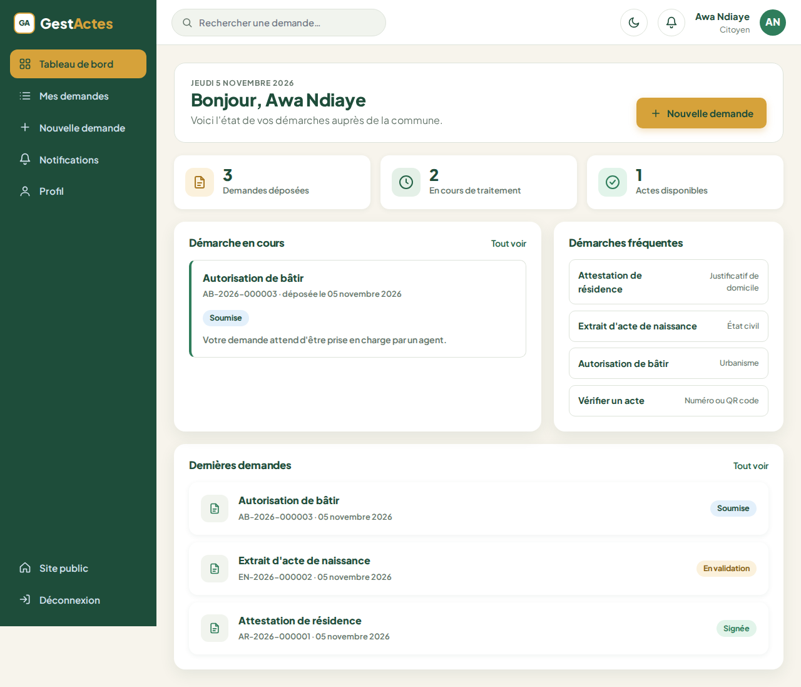
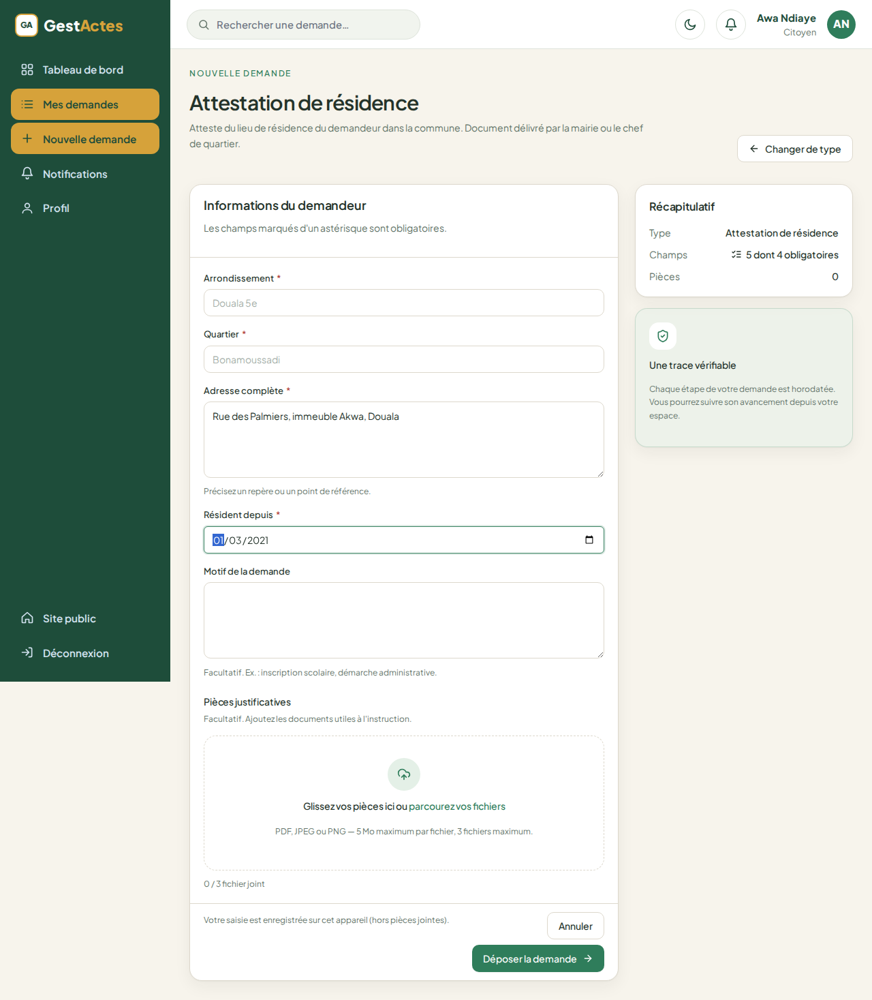
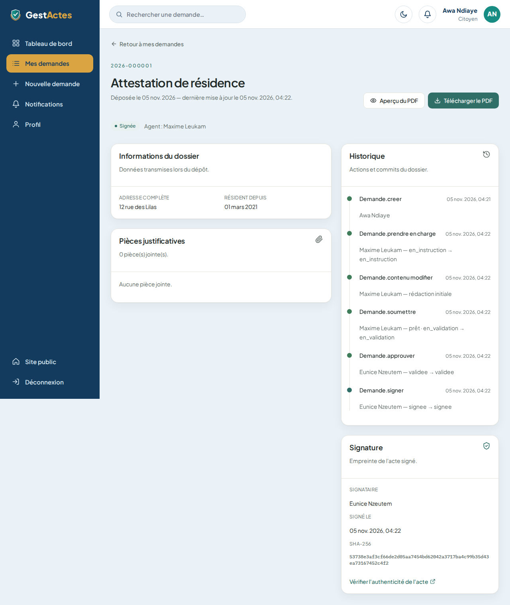
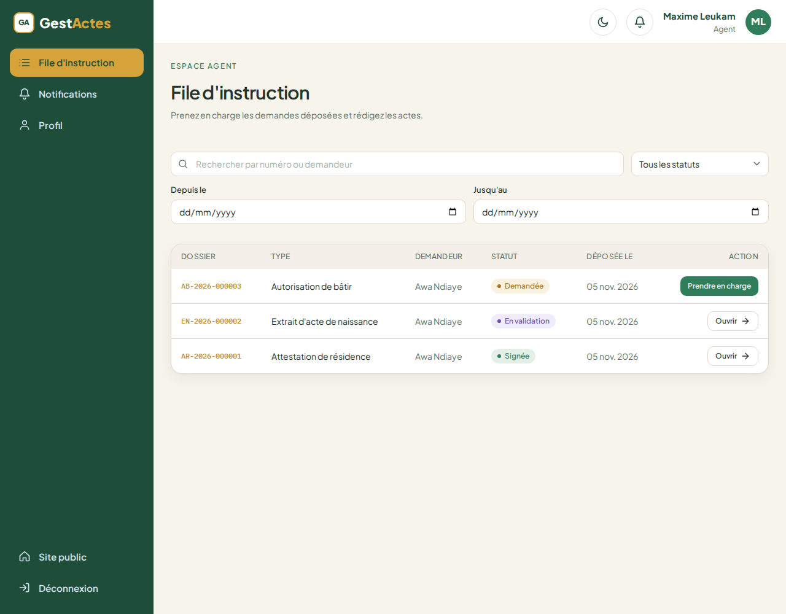
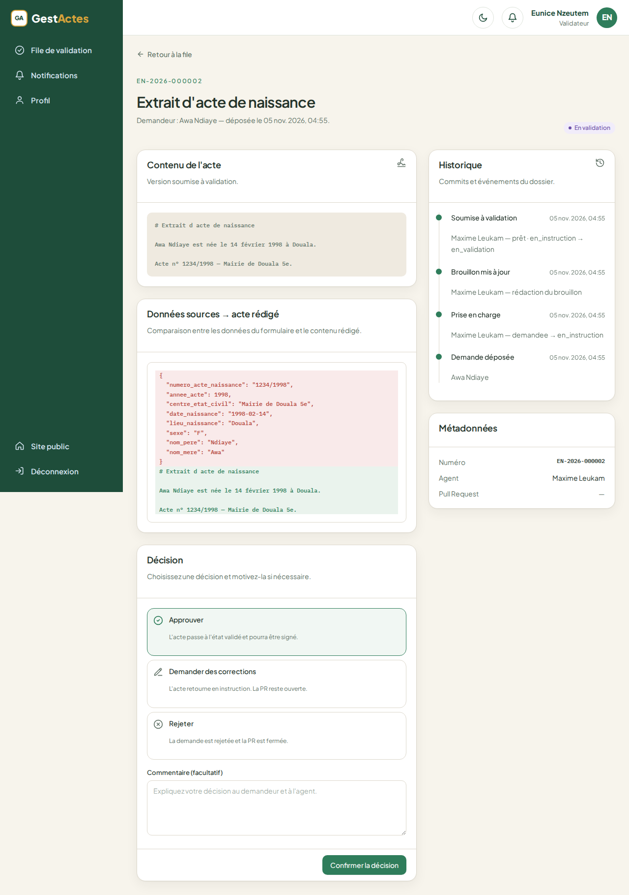
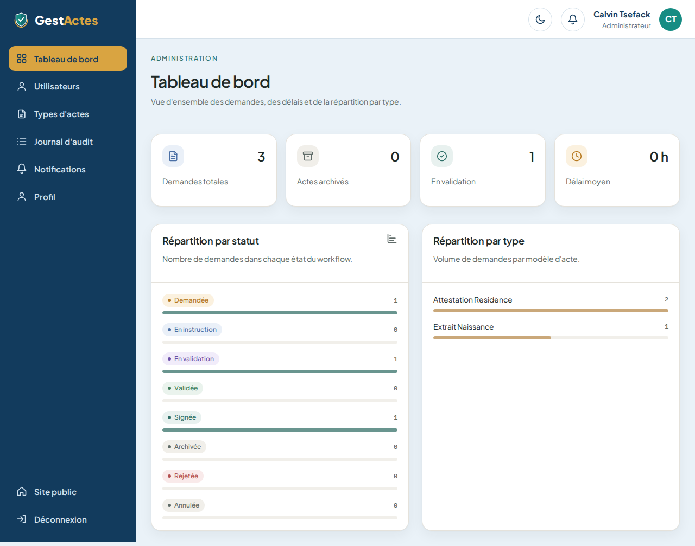
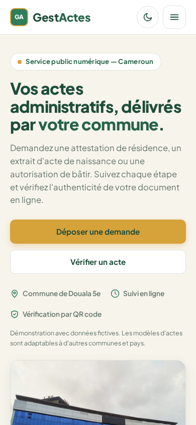
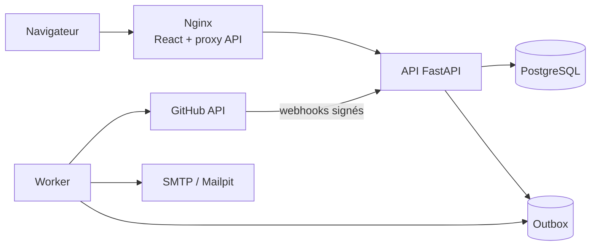

# GestActes

**Gestion des actes administratifs via GitHub**

GestActes est une application web qui permet à un citoyen de demander un acte
administratif, à un agent de l'instruire, à un validateur de le contrôler et de
le signer, puis au système de l'archiver et de le rendre vérifiable.

Le contenu des actes est stocké dans un dépôt GitHub privé : chaque modification
laisse un commit, chaque validation passe par une Pull Request, et chaque acte
signé porte une empreinte SHA-256.

Projet académique — **Architecture logicielle et objets répartis**
École Nationale Supérieure Polytechnique de Douala.


---

## 1. Ce que l'enseignant peut vérifier

| Exigence du cahier des charges | Où la vérifier |
|---|---|
| Création de compte et connexion | `/inscription`, `/connexion` |
| Catalogue de trois types d'actes | Espace citoyen → « Nouvelle demande » |
| Formulaire dynamique et pièces jointes | « Attestation de résidence », etc. |
| Suivi et détail d'une demande | « Mes demandes » |
| Instruction par un agent | Compte agent → « File d'instruction » |
| Validation et signature | Compte validateur → « File de validation » |
| Journal d'audit et statistiques | Compte admin → « Journal d'audit » |
| Vérification publique | `/verifier` |
| Rôles et contrôle d'accès | Chaque espace est protégé par rôle |
| Traçabilité | Timeline d'audit + commits GitHub |
| Architecture répartie | React, FastAPI, worker, PostgreSQL, GitHub, SMTP |
| Tests et CI | `pytest`, `vitest`, GitHub Actions |

---

## 1 bis. Types d'actes et identification

Le jeu de démonstration est adapté aux communes camerounaises. Chaque type
d'acte possède un code, un préfixe de numéro et des champs d'identification
propres.

| Acte | Code | Numéro | Éléments d'identification |
|---|---|---|---|
| Attestation de résidence | `attestation-residence` | `AR-2026-00042` | Nom et prénom, arrondissement, quartier, adresse, date de résidence, signature et QR code. |
| Extrait d'acte de naissance | `extrait-naissance` | `EN-2026-00042` | Numéro et année de l'acte, centre d'état civil, nom, date et lieu de naissance, sexe, père, mère. |
| Autorisation de bâtir | `autorisation-batir` | `AB-2026-00042` | Nature des travaux, parcelle, quartier, surface, titre foncier, date de début, durée de validité. |

Le préfixe permet d'identifier immédiatement la nature de l'acte. Le numéro
complet, l'empreinte SHA-256 et le QR code sont utilisés pour la vérification
publique.

### Contexte étranger

Le modèle n'est pas verrouillé sur le Cameroun : les types d'actes sont
configurables depuis l'administration. Pour un autre pays, il suffit de changer
les modèles, les préfixes, les champs et les mentions légales. La section
« Contexte international » de `docs/contextes-internationaux.md` détaille la
démarche.

---

## 2. Démarrage en une commande

### Prérequis

- **Docker** et **Docker Compose**.
- Un navigateur récent.
- Facultatif : un token GitHub pour l'intégration réelle avec le dépôt
  `gestactes-data`.

### Lancer

```bash
cp .env.example .env
docker compose up --build
```

Le jeu de démonstration est chargé automatiquement au démarrage de l'API
(`AUTO_SEED=true`). Il est idempotent : le relancer ne crée pas de doublons.

Il contient :

- 4 comptes : citoyen, agent, validateur, administrateur ;
- 3 types d'actes camerounais ;
- 9 demandes couvrant tous les états du workflow, avec pièces PDF, historique
  d'audit et notifications ;
- 2 actes signés/archivés dont le PDF et les pièces sont consultables sans
  token GitHub.

Pour rejouer le seed manuellement :

```bash
docker compose exec api python -m app.seed
```

Pour repartir d'une base vide :

```bash
docker compose down -v
docker compose up --build
```

### Ouvrir

| Service | URL |
|---|---|
| Application | http://localhost:8080 |
| API / Swagger | http://localhost:8000/docs |
| Boîte e-mail de test (Mailpit) | http://localhost:8025 |

### Vérifier l'installation

```bash
./scripts/verify-setup.sh
```

Le script vérifie Docker, le fichier `.env`, les services, l'API et le frontend.

---

## 3. Comptes de démonstration

| Rôle | E-mail | Mot de passe |
|---|---|---|
| Citoyen | `citoyen@gestactes.com` | `Demo1234!` |
| Agent | `agent@gestactes.com` | `Demo1234!` |
| Validateur | `validateur@gestactes.com` | `Demo1234!` |
| Administrateur | `admin@gestactes.com` | `Demo1234!` |

Les données sont fictives. Aucune donnée personnelle réelle n'est utilisée.

---

## 4. Parcours de démonstration en 8 étapes

### Étape 1 — Citoyen

1. Ouvrir http://localhost:8080.
2. Se connecter avec `citoyen@gestactes.com`.
3. Cliquer sur **Nouvelle demande**.
4. Choisir **Attestation de résidence**.
5. Remplir l'adresse et la date de résidence.
6. Déposer la demande.
7. Vérifier le numéro, le statut et la timeline.

### Étape 2 — Agent

1. Se déconnecter.
2. Se connecter avec `agent@gestactes.com`.
3. Ouvrir **File d'instruction**.
4. Prendre en charge la demande.
5. Modifier le brouillon de l'acte.
6. Enregistrer, puis **Soumettre à validation**.

### Étape 3 — Validateur

1. Se déconnecter.
2. Se connecter avec `validateur@gestactes.com`.
3. Ouvrir **File de validation**.
4. Examiner le contenu et la comparaison.
5. Approuver, demander des corrections ou rejeter.
6. Si l'acte est approuvé, le signer.

### Étape 4 — Vérification publique

1. Ouvrir http://localhost:8080/verifier.
2. Saisir le numéro de l'acte.
3. Vérifier le résultat : acte valide, type, date, signataire, empreinte.

### Étape 5 — Administration

1. Se connecter avec `admin@gestactes.com`.
2. Consulter les utilisateurs, les types d'actes, l'audit et les statistiques.

---

## 5. Captures d'écran

### Connexion


### Tableau de bord citoyen



### Dépôt d'une demande



### Détail et historique



### File d'instruction agent



### Revue du validateur



### Administration



### Version mobile



---

## 6. Architecture



- **Frontend** : React 18, TypeScript, Vite, Tailwind CSS, icônes Lucide,
  police Plus Jakarta Sans.
- **Backend** : Python 3.12, FastAPI, SQLModel, PostgreSQL 16.
- **Worker** : jobs GitHub, notifications, PDF, archivage.
- **GitHub** : Issues, branches, commits, Pull Requests, reviews, tags.
- **Sécurité** : JWT court, refresh token `HttpOnly`, RBAC, HMAC webhook.
- **Déploiement** : Docker Compose, Nginx, Mailpit en développement.

Détails : `docs/architecture.md` et `docs/workflow.md`.

---

## 7. Tests

### Backend

```bash
cd backend
python3 -m venv .venv
source .venv/bin/activate
pip install -e ".[dev]"
ruff check .
mypy app
pytest
```

### Frontend

```bash
cd frontend
npm install
npm run lint
npm run typecheck
npm run test
npm run build
```

### Résultats attendus

- Backend : **45 tests passent**, 1 test d'intégration GitHub ignoré par défaut.
- Frontend : **83 tests passent**, 3 tests de parcours complets en `todo`.
- Lint, typage et build passent.
- Le parcours API complet a été exécuté : citoyen → agent → validateur →
  signature → vérification.

---

## 8. État actuel du projet

### Fonctionnel

- Inscription, connexion, refresh, déconnexion, profil, reset de mot de passe.
- Catalogue des trois types d'actes.
- Dépôt d'une demande avec formulaire dynamique et pièces.
- Liste, détail, annulation et historique.
- File agent, prise en charge, rédaction, complément, soumission.
- File validateur, revue, approbation, corrections, rejet, signature.
- Administration des utilisateurs, types d'actes, audit et statistiques.
- Notifications internes et e-mails via Mailpit.
- Vérification publique d'un acte.
- Rôles et contrôle d'accès.
- Docker Compose, CI, tests, seed.

### Partiellement configuré

Ces éléments dépendent d'un vrai token GitHub et du dépôt `gestactes-data` :

- création réelle des Issues, branches, commits et Pull Requests ;
- fusion de la PR et récupération du SHA de merge ;
- génération PDF et QR code ;
- archivage et tag Git ;
- téléchargement des pièces et du PDF depuis GitHub ;
- traitement complet des webhooks.

Le code de ces services existe et les contrats sont en place. Sans token, le
parcours métier reste testable en base, mais les opérations GitHub ne sont pas
exécutées.

### Hors périmètre

- Paiement en ligne.
- Signature électronique qualifiée eIDAS.
- Connexion aux registres officiels.
- Application mobile native.
- Mode hors ligne.

---

## 9. Structure du projet

```text
backend/        API FastAPI, modèles, services, worker, tests
frontend/       React, pages publiques, citoyen, agent, validateur, admin
docs/           cahier des charges corrigé, architecture, API, design, recette
scripts/        vérification, création d'issues, simulation webhook
data/demo/      actes et webhooks fictifs
docker-compose.yml
Makefile
```

Chaque fichier source commence par le nom de son propriétaire, son rôle et ses
TODO.

---

## 10. Documentation

| Document | Contenu |
|---|---|
| `docs/cahier-des-charges-v2.md` | Cahier des charges corrigé. |
| `docs/revue-cdc.md` | Audit de la version initiale. |
| `docs/architecture.md` | Architecture et décisions. |
| `docs/workflow.md` | États, transitions, rôles. |
| `docs/api-contract.md` | Contrat REST. |
| `docs/design-system.md` | Palette, typographie, composants. |
| `docs/tests.md` | Stratégie de tests. |
| `docs/recette.md` | Scénarios de recette. |
| `docs/demo.md` | Script de démonstration. |
| `docs/rapport-integration.md` | Réconciliation des travaux de l'équipe. |
| `docs/contextes-internationaux.md` | Adaptation à d'autres pays et collectivités. |
| `docs/onboarding.md` | Parcours d'arrivée d'un nouveau membre. |
| `docs/repartition-taches.md` | Propriétaires, branches, tâches. |

---

## 11. Équipe

| Membre | Rôle |
|---|---|
| TSEFACK CALVIN KLEIN | Intégration, contrats, CI, releases |
| GUEMOGNE GERALDINE ESTHER | Design system, auth, public |
| JEUDIEU TSAGUE AUDREY DANIELLE | Parcours citoyen |
| KOUODZO ZANGUE REGINA | Auth back, utilisateurs, audit |
| LEUKAM TCHEUMALEU MAXIME | Parcours agent |
| METAMMO TEUMA DANIELA CLEDYA | Parcours validateur |
| NDOUNGUE ESSOH ABEL THOMAS | Actes, demandes, workflow |
| NOLACK KAWUNJIBI FRANGE PARKER | GitHub, worker, notifications, PDF |
| NZEUTEM DOMOE EUNICE FELIXTINE | Administration front, suivi projet |
| VOUMIA OUALA DILANE | Qualité, tests, seed, recette, démo |

Encadrant : **M. TCHUIGOUA CHARLU**.

---

## 12. Dépannage rapide

| Problème | Solution |
|---|---|
| Port déjà utilisé | Arrêter le service concerné ou modifier les ports dans `docker-compose.yml`. |
| Base vide | `docker compose exec api python -m app.seed`. |
| Token GitHub absent | Le parcours métier fonctionne ; les opérations GitHub restent en attente. |
| Webhook non reçu en local | Utiliser `python scripts/simulate_webhook.py` ou smee.io. |
| Frontend non chargé | Vérifier `docker compose ps` et `docker compose logs web`. |
| API non disponible | Vérifier `http://localhost:8000/health`. |
| Tests locaux | Activer le venv backend et lancer `npm install` dans `frontend`. |

---

## 13. Crédits

- Photo de la mairie : **Minette Lontsie**, Wikimedia Commons, licence **CC BY-SA 4.0**. Source : `File:Mairie_de_Douala_V.jpg`.
- Icônes : Lucide via `react-icons`.
- Police : Plus Jakarta Sans.
- Logo : monogramme HTML/CSS, sans image générée.

---

## 14. Licence et contexte

Projet académique réalisé dans le cadre du module **Architecture logicielle et
objets répartis** à l'ENSPD. Les données sont fictives et le projet n'a aucune
valeur légale.
