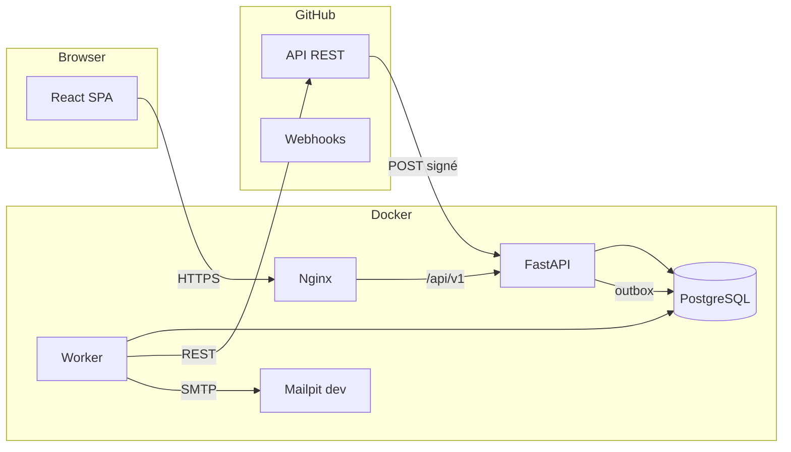
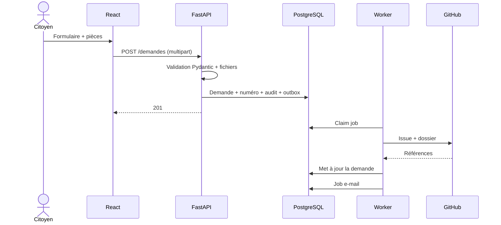
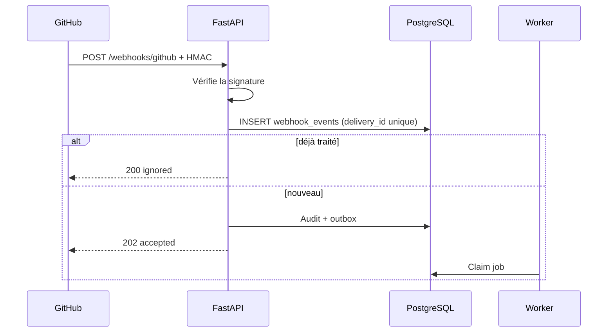

# Architecture GestActes

**Propriétaire :** NDOUNGUE ESSOH ABEL THOMAS
**Version :** 2.0
**Statut :** baseline validée par l'intégrateur

---

## 1. Objectif

Ce document décrit l'architecture réellement retenue pour le MVP. Il remplace
les figures 2, 4 et 5 du cahier des charges initial. L'objectif est de rester
simple tout en conservant les propriétés demandées par le cours : composants
distincts, communication à distance, asynchronisme, résilience et sécurité.

## 2. Contraintes structurantes

| Contrainte | Conséquence |
|---|---|
| 8 semaines, 10 personnes | Pas de microservices, pas de RabbitMQ. |
| GitHub comme référentiel | Le contenu des actes vit dans un dépôt de données. |
| Traçabilité | Chaque action métier écrit un audit et, si possible, un commit. |
| Panne GitHub | Les écritures passent par une outbox persistante. |
| Sécurité | JWT court, refresh cookie, RBAC, webhook HMAC. |
| Déploiement | Une seule commande Docker Compose. |

## 3. Vue des composants



### 3.1 Client web

- React 18 + TypeScript + Vite.
- Tailwind CSS + composants maison + `react-icons/lu`.
- React Router pour les routes protégées par rôle.
- TanStack Query pour le cache et les états de chargement.
- Aucun accès direct à GitHub : tout passe par l'API.

### 3.2 API

Découpage interne par domaine :

```text
app/
  api/routes/     auth, demandes, actes, types_actes, admin,
                  notifications, verification, webhooks, health
  models/         SQLModel
  schemas/        Pydantic
  services/       logique métier
  core/           config, sécurité, dépendances, erreurs
  worker/         jobs asynchrones
```

Règles :

- Une route ne contient pas de logique métier complexe.
- Un service ne dépend pas de FastAPI.
- Les modèles ne connaissent pas les schémas Pydantic.
- Les transitions de statut passent toutes par `workflow_service`.
- Les appels GitHub passent tous par `github_service`.

### 3.3 Worker

Le worker est un second processus de la même image. Il réclame les jobs de la
table `outbox_jobs` avec un verrou (`SELECT ... FOR UPDATE SKIP LOCKED`) et les
traite un par un.

Types de jobs :

| Job | Effet |
|---|---|
| `github.provision_demande` | Crée l'Issue et le dossier de l'acte. |
| `github.commit_acte` | Commit `acte.json` et `acte.md` sur la branche. |
| `github.open_pr` | Ouvre la PR de validation. |
| `github.merge_pr` | Fusionne la PR signée. |
| `github.archive` | Copie dans `archives/` et pose le tag. |
| `email.send` | Envoie un e-mail. |
| `pdf.generate` | Génère le PDF et le QR code. |
| `notification.create` | Crée une notification interne. |

Le worker est idempotent : avant de créer une Issue ou une branche, il vérifie
si elle existe déjà. En cas d'échec, il incrémente `attempts`, calcule un
`run_at` avec backoff et enregistre `last_error`.

### 3.4 PostgreSQL

Source de vérité pour :

- les comptes, rôles et sessions ;
- l'état du workflow ;
- les métadonnées des demandes et des pièces ;
- l'audit ;
- les notifications ;
- l'outbox ;
- les webhooks reçus.

Le contenu des actes n'est pas stocké en base, sauf un index de recherche et
les données du formulaire nécessaires à l'affichage.

### 3.5 GitHub

- Dépôt `gestactes-data` privé.
- `main` protégée : PR obligatoire, une approbation, checks verts.
- Un dossier par acte, une branche par acte, une PR par acte.
- Les labels miroir des statuts.
- Les webhooks renvoient les événements vers l'API.
- Le PAT est limité au dépôt de données.

### 3.6 Nginx

- Sert le build React.
- Proxy `/api` vers l'API.
- Compression gzip.
- Cache long pour les assets hashés, pas de cache pour `index.html`.
- Limitation de débit sur `/api/v1/auth/login` et `/api/v1/verification`.
- En-têtes de sécurité de base.

## 4. Flux principaux

### 4.1 Dépôt d'une demande



Point clé : la demande est **committée en base avant** l'appel GitHub. Une panne
GitHub ne perd donc jamais la demande.

### 4.2 Instruction

1. L'agent prend en charge : `demandee -> en_instruction`.
2. Le worker crée la branche et assigne l'Issue.
3. Le worker génère `acte.json` et `acte.md`.
4. Chaque sauvegarde de l'agent crée un commit.
5. La soumission ouvre une PR et passe à `en_validation`.

### 4.3 Validation et signature

1. Le validateur approuve : `en_validation -> validee`.
2. La signature calcule les hash, écrit `signature.json`, merge la PR.
3. Le SHA du merge est enregistré en base.
4. Le worker génère le PDF, copie dans `archives/`, pose le tag.
5. La demande passe à `archivee`.

### 4.4 Webhook



## 5. Frontières et dépendances

```text
frontend  --->  API  --->  services  --->  models  --->  DB
                  |            |
                  |            +--> github_service ---> GitHub
                  |            +--> notification_service ---> SMTP
                  |
                  +--> outbox_jobs <--- worker
```

Règles d'import :

- `api/routes` peut importer `schemas`, `services`, `core`.
- `services` peut importer `models`, `core`, `schemas`.
- `models` n'importe que SQLModel.
- `worker` peut importer `services`, `models`, `core`.
- Aucun import de `api/routes` depuis un service.
- Aucun import de FastAPI depuis un modèle.

## 6. Décisions d'architecture (ADR)

### ADR-01 — Monolithe modulaire plutôt que microservices

**Contexte :** six services + gateway + RabbitMQ pour 8 semaines.
**Décision :** une API modulaire + un worker.
**Conséquence :** moins de configuration, plus de temps pour le métier et les
tests. Les frontières de dossiers permettent une extraction ultérieure.

### ADR-02 — Outbox plutôt que RabbitMQ

**Contexte :** besoin de fiabilité sans infrastructure de message.
**Décision :** table `outbox_jobs` + worker avec verrou.
**Conséquence :** transactionnel avec la base, simple à tester, suffisant pour
le volume du projet.

### ADR-03 — PDF généré par le worker

**Contexte :** GitHub Actions ne peut pas pousser sur `main` protégée.
**Décision :** le worker génère le PDF après le merge et le commit via l'API.
**Conséquence :** une seule logique de génération, testable, pas de conflit avec
la protection de branche.

### ADR-04 — Signature par manifeste séparé

**Contexte :** un hash stocké dans le fichier qu'il hashe est impossible.
**Décision :** `signature.json` signe `acte.json` et `acte.md`.
**Conséquence :** vérification reproductible ; le SHA du merge est une métadonnée
externe.

### ADR-05 — Pas d'Alembic au MVP

**Contexte :** schéma figé avant le développement, équipe débutante.
**Décision :** `SQLModel.metadata.create_all` + seed.
**Conséquence :** démarrage simple ; Alembic est documenté comme évolution dès
qu'un changement de schéma en production est nécessaire.

## 7. Sécurité

Voir `docs/cahier-des-charges-v2.md`, section 6.12. Les points implémentés dans
le code sont :

- `core/security.py` : hash, JWT, tokens opaques.
- `core/deps.py` : utilisateur courant, rôles.
- `services/auth_service.py` : rotation et révocation.
- `services/workflow_service.py` : transitions et autorisations.
- `services/github_client.py` : token, timeouts, retries.
- `api/routes/webhooks.py` : HMAC et idempotence.

## 8. Observabilité

- Logs structurés avec `request_id`.
- `/health` : état de l'API.
- `/health/ready` : vérification de la base.
- Table `audit_events` : actions métier.
- Table `outbox_jobs` : jobs en échec visibles par l'admin.
- Les erreurs 5xx sont journalisées avec la stack, jamais renvoyées au client.

## 9. Évolution possible

Si le projet devait grandir :

1. Extraire le worker dans un service dédié (déjà séparé).
2. Remplacer l'outbox par RabbitMQ ou Redis Streams.
3. Extraire `auth` et `github` en services.
4. Ajouter Alembic.
5. Ajouter un stockage objet pour les pièces volumineuses.
6. Ajouter une GitHub App à la place du PAT.
