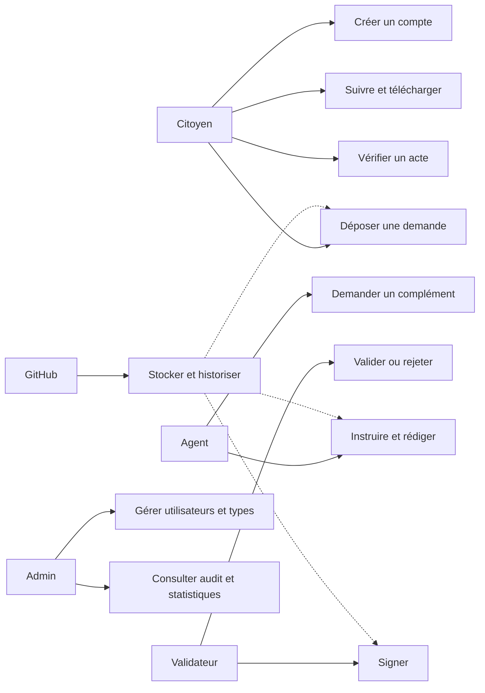
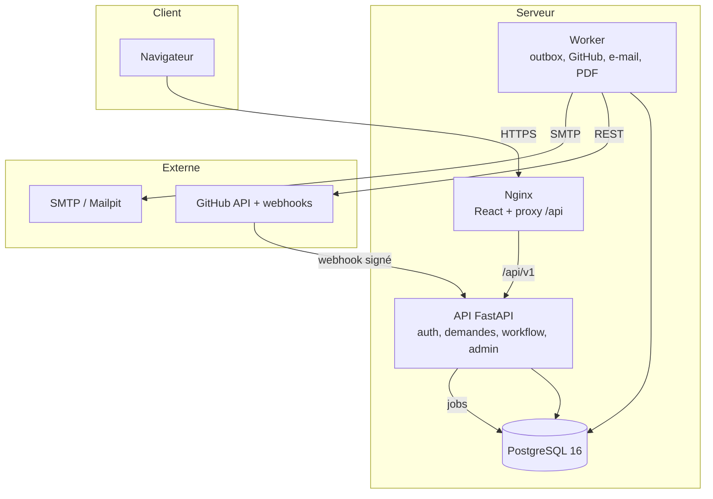
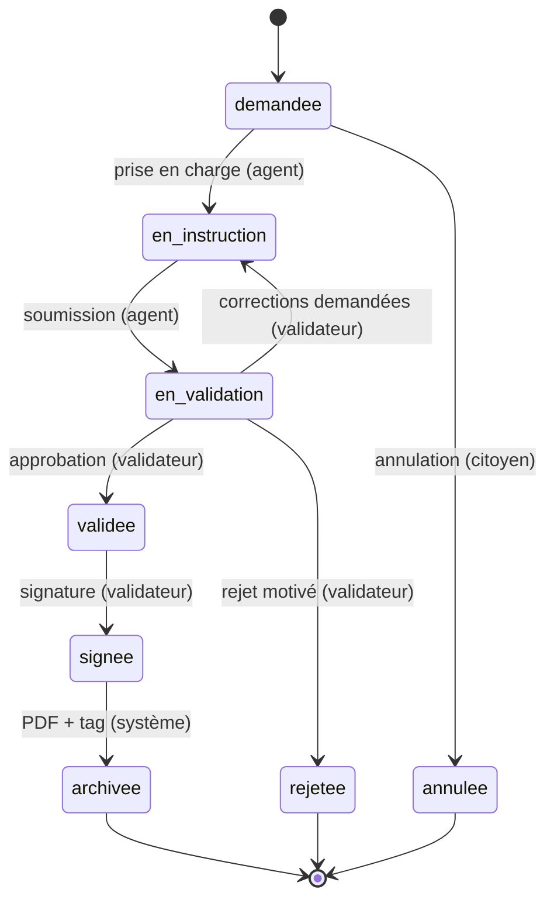
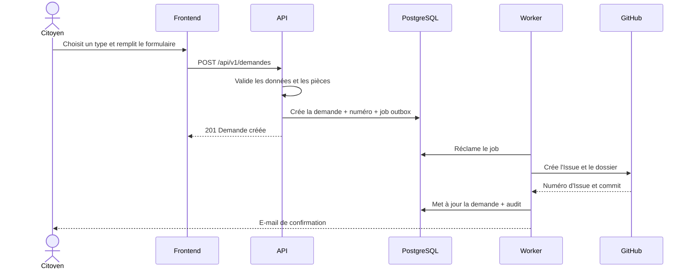
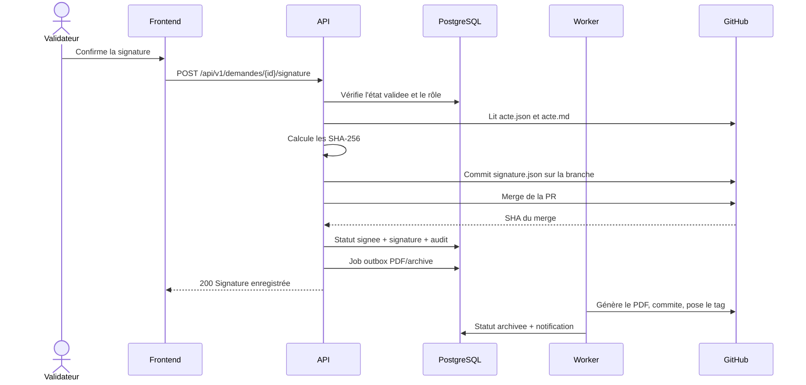

# GestActes — Cahier des charges corrigé

**Projet :** Gestion des actes administratifs via GitHub
**Version :** 2.0
**Date :** Novembre 2026
**Établissement :** École Nationale Supérieure Polytechnique de Douala
**Module :** Architecture logicielle et objets répartis
**Encadrant :** M. TCHUIGOUA CHARLU

**Équipe :**

| Membre | Rôle dans le projet |
|---|---|
| TSEFACK CALVIN KLEIN | Responsable intégration, revue et releases |
| GUEMOGNE GERALDINE ESTHER | Front-end — design system, authentification, pages publiques |
| JEUDIEU TSAGUE AUDREY DANIELLE | Front-end — parcours citoyen |
| KOUODZO ZANGUE REGINA | Back-end — authentification, utilisateurs, audit |
| LEUKAM TCHEUMALEU MAXIME | Front-end — parcours agent |
| METAMMO TEUMA DANIELA CLEDYA | Front-end — parcours validateur |
| NDOUNGUE ESSOH ABEL THOMAS | Back-end — actes, demandes, workflow |
| NOLACK KAWUNJIBI FRANGE PARKER | Back-end — GitHub, worker, notifications |
| NZEUTEM DOMOE EUNICE FELIXTINE | Front-end — administration et suivi projet |
| VOUMIA OUALA DILANE | Qualité, tests, données de démonstration, documentation de recette |

---

## 1. Introduction et contexte

### 1.1 Contexte

Les administrations produisent chaque jour des actes administratifs : attestations,
extraits d'actes d'état civil, décisions, certificats, autorisations. Leur
traitement repose souvent sur des circuits papier ou sur des outils dispersés.
Le suivi est difficile, les délais s'allongent et la traçabilité des décisions
devient fragile.

Un acte administratif partage plusieurs besoins avec un code source : il doit
être historisé, relu, validé par plusieurs personnes, protégé par des droits
précis et archivé de manière fiable. Git et GitHub fournissent nativement ces
mécanismes : commits horodatés, branches, Pull Requests, revues, protection de
branches, tags et automatisations.

GestActes est une application web répartie qui utilise GitHub comme référentiel
de stockage, de versionnage et de traçabilité des actes administratifs. Elle
permet à un citoyen de déposer une demande, à un agent de l'instruire, à un
validateur de la contrôler et de la signer, puis au système de l'archiver et de
la rendre vérifiable.

### 1.2 Problématique

Comment concevoir une application répartie, simple à exploiter, qui gère le
cycle de vie complet d'un acte administratif — demande, instruction, validation,
signature, archivage — tout en garantissant sa traçabilité, son intégrité et son
auditabilité grâce à GitHub ?

### 1.3 Objectifs

**Objectif général**

Fournir une plateforme web permettant aux citoyens de demander des actes et aux
agents de l'administration de les instruire, valider, signer et archiver, avec
GitHub comme référentiel unique et auditable du contenu des actes.

**Objectifs spécifiques**

- Dématérialiser le circuit de traitement de trois types d'actes.
- Modéliser le cycle de vie d'un acte sur les concepts GitHub : Issue, branche,
  Pull Request, revue, merge, tag.
- Concevoir une architecture répartie légère : client web, API, worker,
  PostgreSQL, GitHub et SMTP.
- Garantir la traçabilité de chaque action : auteur, date, contenu avant/après,
  SHA du commit.
- Offrir une interface claire, responsive et accessible à chaque rôle.
- Documenter l'analyse, la conception, les choix techniques, les tests et la
  recette.

### 1.4 Périmètre

**Inclus dans la version 1**

- Trois types d'actes : attestation de résidence, extrait d'acte de naissance,
  autorisation administrative simple.
- Gestion des comptes et des rôles : citoyen, agent, validateur, administrateur.
- Dépôt et suivi des demandes, pièces justificatives, instruction, validation,
  signature simulée, archivage, recherche, historique.
- Notifications par e-mail et notifications internes.
- Intégration à l'API REST GitHub et aux webhooks.
- Application web responsive en français.
- Vérification publique d'un acte par numéro ou QR code.
- Déploiement par `docker compose up`.

**Hors périmètre**

- Paiement en ligne des timbres ou frais administratifs.
- Signature électronique qualifiée au sens du règlement eIDAS. La signature est
  simulée par une empreinte SHA-256 horodatée et rattachée à l'identité du
  validateur.
- Interconnexion avec les registres officiels d'état civil. Les données sont
  fictives.
- Application mobile native, mode hors ligne, thème sombre.
- Messagerie externe RabbitMQ/Kafka, microservices déployés séparément,
  GitHub App, multi-tenant, internationalisation.

### 1.5 Glossaire

| Terme | Définition |
|---|---|
| Acte administratif | Document officiel émis par une administration, qui produit des effets juridiques ou atteste d'un fait. |
| Dépôt (repository) | Espace GitHub contenant des fichiers et leur historique. |
| Commit | Enregistrement horodaté d'un ensemble de modifications, avec auteur et message. |
| Branche | Ligne de développement parallèle. |
| Issue | Ticket GitHub représentant une demande de citoyen. |
| Pull Request (PR) | Demande de fusion d'une branche, soumise à revue. |
| GitHub Actions | Automatisation déclenchée par un événement GitHub. |
| Webhook | Appel HTTP envoyé par GitHub à l'application lors d'un événement. |
| API REST | Interface HTTP/JSON exposant les ressources de l'application. |
| JWT | Jeton signé transportant l'identité et le rôle d'un utilisateur. |
| RBAC | Contrôle d'accès fondé sur les rôles. |
| Outbox | Table de jobs persistants traités de manière asynchrone par le worker. |
| SPA | Single Page Application : application web chargée une fois et mise à jour dynamiquement. |
| PAT | Personal Access Token GitHub, à droits limités. |

---

## 2. Acteurs et rôles

| Acteur | Description | Droits principaux |
|---|---|---|
| Citoyen | Personne qui sollicite un acte. | Créer un compte, déposer une demande, joindre des pièces, suivre ses demandes, annuler une demande non prise en charge, télécharger ses actes signés. |
| Agent | Employé chargé d'instruire les demandes et de rédiger les actes. | Consulter la file, prendre en charge, rédiger et modifier un brouillon, demander un complément, soumettre à validation, consulter l'historique. |
| Validateur | Responsable hiérarchique habilité à valider et signer. | Consulter les actes en attente, comparer les versions, approuver, demander des corrections, rejeter, signer. |
| Administrateur | Responsable technique et fonctionnel. | Gérer les utilisateurs et rôles, les types d'actes, consulter l'audit et les statistiques. |
| GitHub | Système externe. | Stocke les actes, expose l'API REST, émet des webhooks, exécute les Actions. |
| SMTP | Système externe. | Distribue les e-mails. |

**Règle de simplicité :** un utilisateur possède un seul rôle dans la version 1.
Les comptes agent, validateur et administrateur sont créés par un administrateur.
Un citoyen ne peut consulter que ses propres demandes.

---

## 3. Besoins fonctionnels

Les exigences sont identifiées par `EF-xx` et classées par priorité :

- **Haute** : indispensable au MVP.
- **Moyenne** : souhaitable pour la démonstration.
- **Basse** : optionnelle, si le temps le permet.

### 3.1 Authentification et comptes

| ID | Besoin | Priorité | Acteur | Critère d'acceptation |
|---|---|---|---|---|
| EF-01 | Créer un compte citoyen (nom, prénom, e-mail, mot de passe). | Haute | Citoyen | Un e-mail unique et un mot de passe de 8 caractères minimum créent un compte ; le mot de passe est haché ; un doublon renvoie 409. |
| EF-02 | Se connecter et se déconnecter de façon sécurisée. | Haute | Tous | Les identifiants valides renvoient un jeton d'accès court et un cookie de rafraîchissement `HttpOnly` ; la déconnexion révoque le refresh token. |
| EF-03 | Appliquer un contrôle d'accès par rôle sur toutes les fonctionnalités. | Haute | Système | Une route interdite renvoie 403 ; un citoyen ne voit jamais la demande d'un autre. |
| EF-04 | Réinitialiser son mot de passe par e-mail. | Moyenne | Tous | Un token à usage unique et expiration 30 minutes est envoyé ; le mot de passe est remplacé et toutes les sessions sont révoquées. |
| EF-05 | Consulter et modifier son profil. | Basse | Tous | Le nom et le prénom sont modifiables ; l'e-mail ne l'est pas dans le MVP. |

### 3.2 Gestion des demandes

| ID | Besoin | Priorité | Acteur | Critère d'acceptation |
|---|---|---|---|---|
| EF-06 | Consulter le catalogue des types d'actes disponibles. | Haute | Citoyen | Les types actifs sont listés avec leur description et leur schéma de formulaire. |
| EF-07 | Remplir un formulaire dynamique et joindre des pièces. | Haute | Citoyen | Les champs requis sont validés ; 3 pièces maximum, 5 Mo par pièce, PDF/JPEG/PNG uniquement ; une erreur affiche le champ concerné. |
| EF-08 | Créer automatiquement une Issue GitHub et le dossier de l'acte. | Haute | Système | La demande est enregistrée en base puis un job outbox crée l'Issue et le dossier `actes/<type>/<année>/<numéro>/` ; une panne GitHub ne perd pas la demande. |
| EF-09 | Suivre l'état et l'historique de ses demandes. | Haute | Citoyen | Le citoyen voit ses demandes, leur statut, la timeline et les messages. |
| EF-10 | Annuler une demande tant qu'elle n'est pas prise en charge. | Moyenne | Citoyen | L'annulation n'est possible qu'à l'état `demandee` ; sinon 409. L'Issue est fermée avec le label `statut:annulee`. |
| EF-11 | Télécharger l'acte signé au format PDF. | Haute | Citoyen | Le PDF est disponible après signature ; un citoyen ne télécharge que ses propres actes. |

### 3.3 Instruction et rédaction

| ID | Besoin | Priorité | Acteur | Critère d'acceptation |
|---|---|---|---|---|
| EF-12 | Consulter la file des demandes avec filtres. | Haute | Agent | Filtres type, statut, date, recherche ; pagination ; seules les demandes pertinentes sont visibles. |
| EF-13 | Prendre en charge une demande. | Haute | Agent | La demande passe à `en_instruction`, l'Issue est assignée, la branche `acte/<année>-<numéro>` est créée, un événement d'audit est écrit. |
| EF-14 | Générer le brouillon à partir du modèle et des données du citoyen. | Haute | Agent | `acte.json` et `acte.md` sont créés sur la branche ; l'opération est idempotente. |
| EF-15 | Modifier le brouillon ; chaque enregistrement crée un commit. | Haute | Agent | Le contenu est validé, commité sur la branche avec un message normalisé, et journalisé. |
| EF-16 | Demander un complément d'information ou une pièce. | Moyenne | Agent | Un message et une notification sont envoyés au citoyen ; la demande reste `en_instruction` avec l'indicateur `complement_attendu`. |
| EF-17 | Soumettre l'acte à validation. | Haute | Agent | Une PR est ouverte vers `main`, la demande passe à `en_validation`, les validateurs sont notifiés. |

### 3.4 Validation et signature

| ID | Besoin | Priorité | Acteur | Critère d'acceptation |
|---|---|---|---|---|
| EF-18 | Consulter les actes en attente avec les différences. | Haute | Validateur | La file liste les demandes `en_validation` ; la page de revue affiche le contenu, l'historique et les différences. |
| EF-19 | Approuver, demander des corrections ou rejeter. | Haute | Validateur | Approbation → `validee` ; corrections → `en_instruction` avec commentaire ; rejet → `rejetee` avec commentaire obligatoire et fermeture de la PR/Issue. |
| EF-20 | Signer l'acte. | Haute | Validateur | La signature n'est possible qu'à l'état `validee` ; `signature.json` contient le hash SHA-256 de `acte.json` et `acte.md`, l'identité et l'horodatage ; la PR est fusionnée ; le SHA du merge est enregistré. |
| EF-21 | Générer le PDF avec numéro unique et QR code. | Moyenne | Système | Le worker génère `acte.pdf`, le commit dans `archives/`, pose le tag `acte-<année>-<numéro>-v1` et passe la demande à `archivee`. |
| EF-22 | Vérifier l'authenticité d'un acte. | Basse | Public | La page `/verification/<numéro>` affiche valide/invalide, le type, la date de signature et le nom du signataire, sans données personnelles. |

### 3.5 Recherche, historique et archivage

| ID | Besoin | Priorité | Acteur | Critère d'acceptation |
|---|---|---|---|---|
| EF-23 | Rechercher des actes par numéro, type, date, statut ou demandeur. | Haute | Agent, validateur, admin | Recherche plein texte limitée aux champs autorisés, pagination, résultats filtrés par rôle. |
| EF-24 | Consulter l'historique complet d'un acte. | Haute | Citoyen propriétaire, agent, validateur, admin | La timeline fusionne les commits GitHub et les événements d'audit, avec auteur et date. |
| EF-25 | Archiver un acte signé. | Moyenne | Système | Copie dans `archives/<année>/<numéro>/`, tag Git, statut `archivee`, aucune modification ultérieure. |
| EF-26 | Exporter une liste d'actes au format CSV. | Basse | Agent, validateur, admin | Export UTF-8 avec BOM, filtres appliqués, données limitées aux colonnes autorisées. |

### 3.6 Administration

| ID | Besoin | Priorité | Acteur | Critère d'acceptation |
|---|---|---|---|---|
| EF-27 | Créer, modifier, désactiver des utilisateurs et attribuer des rôles. | Haute | Administrateur | CRUD complet ; un admin ne peut pas se désactiver lui-même ni désactiver le dernier admin. |
| EF-28 | Gérer les types d'actes et leur schéma de formulaire. | Moyenne | Administrateur | Création/modification/désactivation ; le schéma est validé ; un type utilisé ne peut pas être supprimé physiquement. |
| EF-29 | Consulter le journal d'audit. | Moyenne | Administrateur | Liste append-only, filtres acteur/action/date, pagination. |
| EF-30 | Visualiser un tableau de bord. | Basse | Administrateur | Nombre de demandes par statut, délai moyen de traitement, volume par type. |

### 3.7 Notifications

| ID | Besoin | Priorité | Acteur | Critère d'acceptation |
|---|---|---|---|---|
| EF-31 | Envoyer un e-mail à chaque changement d'état. | Moyenne | Système | Un job outbox est créé à chaque transition ; l'échec est retenté avec backoff ; Mailpit reçoit l'e-mail en développement. |
| EF-32 | Afficher des notifications dans l'interface. | Basse | Tous | Cloche avec compteur, liste, marquage lu/non lu, lien vers la demande. |

---

## 4. Besoins non fonctionnels

| Catégorie | Exigence | Critère de vérification |
|---|---|---|
| Sécurité | JWT court, refresh token `HttpOnly` avec rotation, bcrypt, RBAC, validation Pydantic, secrets hors dépôt, token GitHub à droits minimaux. | Tests d'autorisation par rôle ; aucun secret dans Git ; refresh révoqué après logout. |
| Intégrité et traçabilité | Toute modification d'un acte produit un commit avec auteur ; les actes signés ne sont plus modifiables ; audit append-only. | Historique Git cohérent avec `audit_events` ; test de tentative de modification après signature. |
| Performance | Lectures locales < 500 ms hors GitHub ; création d'une demande < 3 s. | Mesure sur jeu de démonstration ; index sur les colonnes de filtre. |
| Disponibilité et résilience | Une panne GitHub ne perd pas une demande ; les jobs sont rejoués avec backoff. | Test avec GitHub simulé indisponible ; job `pending` puis rejoué. |
| Scalabilité | API et worker sans état, conteneurisés, duplicables. | Deux instances API derrière Nginx ; worker avec verrou de job. |
| Interopérabilité | API REST JSON documentée par OpenAPI 3. | `/docs` et `/openapi.json` accessibles ; tests de schéma. |
| Maintenabilité | Code typé, lint, tests, CI. | Ruff + mypy + ESLint + tsc + pytest + Vitest au vert. |
| Utilisabilité | Interface française, responsive, messages clairs, états de chargement/erreur/vide. | Parcours principal en moins de 5 clics par étape ; test mobile 375 px. |
| Accessibilité | Contraste, focus visible, labels, navigation clavier, `prefers-reduced-motion`. | Audit Lighthouse accessibilité ≥ 90 sur les pages principales. |
| Portabilité | Déploiement complet par Docker Compose. | `docker compose up --build` sur machine vierge. |
| Conformité | Données fictives, dépôt privé, minimisation, pas d'e-mail dans les actes. | Revue de conformité ; `acte.json` sans e-mail. |
| Quotas GitHub | Requêtes conditionnelles, cache, webhooks plutôt que polling. | Consommation < 50 % du quota en usage normal. |
| Observabilité | Logs structurés, `request_id`, endpoint `/health`. | Chaque requête possède un identifiant corrélé. |

---

## 5. Cas d'utilisation

### 5.1 Vue d'ensemble



### 5.2 UC-01 — S'inscrire et se connecter

| Élément | Description |
|---|---|
| Acteur | Citoyen |
| Préconditions | Aucune. |
| Scénario nominal | 1. Le citoyen ouvre `/inscription`. 2. Il saisit nom, prénom, e-mail, mot de passe. 3. Le système valide et crée le compte avec le rôle `citoyen`. 4. Il est redirigé vers la connexion. |
| Alternatives | E-mail déjà utilisé → 409 ; mot de passe trop court → 422 ; compte désactivé → 403 à la connexion. |
| Postconditions | Le compte existe, le mot de passe est haché, aucune session n'est ouverte automatiquement. |

### 5.3 UC-02 — Déposer une demande

| Élément | Description |
|---|---|
| Acteur | Citoyen |
| Préconditions | Citoyen authentifié et actif. |
| Scénario nominal | 1. Il choisit un type d'acte. 2. Le formulaire dynamique s'affiche. 3. Il renseigne les champs et joint ses pièces. 4. Le système valide. 5. Il enregistre la demande avec un numéro unique. 6. Il enfile un job GitHub pour créer l'Issue et le dossier. 7. Il confirme et notifie. |
| Alternatives | Champ invalide → 422 et retour au formulaire ; pièce trop lourde → 413 ; GitHub indisponible → demande conservée, job en attente. |
| Postconditions | Demande `demandee`, numéro unique, job outbox créé. |

### 5.4 UC-03 — Instruire et rédiger

| Élément | Description |
|---|---|
| Acteur | Agent |
| Préconditions | Demande `demandee`. |
| Scénario nominal | 1. L'agent ouvre la file. 2. Il prend en charge : `en_instruction`, branche créée, Issue assignée. 3. Le système génère `acte.json` et `acte.md`. 4. L'agent modifie et enregistre ; chaque enregistrement crée un commit. 5. Il soumet : PR ouverte, `en_validation`. |
| Alternatives | Pièce manquante → complément demandé, la demande reste `en_instruction` ; GitHub indisponible → job en attente. |
| Postconditions | PR ouverte, historique de commits disponible. |

### 5.5 UC-04 — Valider ou rejeter

| Élément | Description |
|---|---|
| Acteur | Validateur |
| Préconditions | Demande `en_validation`, PR ouverte. |
| Scénario nominal | 1. Il consulte le contenu et les différences. 2. Il approuve : `validee`. |
| Alternatives | Corrections : commentaire obligatoire, `en_instruction`, la PR reste ouverte. Rejet : commentaire obligatoire, `rejetee`, PR et Issue fermées. |
| Postconditions | État cohérent avec la décision, audit écrit, notification envoyée. |

### 5.6 UC-05 — Signer

| Élément | Description |
|---|---|
| Acteur | Validateur |
| Préconditions | Demande `validee`, PR ouverte, validateur habilité. |
| Scénario nominal | 1. Il confirme la signature. 2. Le système calcule le hash de `acte.json` et `acte.md`, écrit `signature.json`, fusionne la PR. 3. Il enregistre le SHA du merge, le signataire et l'horodatage. 4. Il passe à `signee` et enfile la génération PDF. |
| Alternatives | Merge impossible → signature annulée, erreur journalisée, état conservé. |
| Postconditions | `signature.json` présent, merge effectué, PDF en attente. |

### 5.7 UC-06 — Vérifier un acte

| Élément | Description |
|---|---|
| Acteur | Public |
| Préconditions | Numéro d'acte. |
| Scénario nominal | 1. L'utilisateur saisit le numéro ou scanne le QR code. 2. Le système retourne valide/invalide, type, date, signataire. |
| Alternatives | Numéro inconnu → 404 ; acte non signé → « non valide ». |
| Postconditions | Aucune donnée personnelle n'est exposée. |

### 5.8 UC-07 — Administrer

| Élément | Description |
|---|---|
| Acteur | Administrateur |
| Préconditions | Rôle `admin`. |
| Scénario nominal | 1. Il crée un agent ou un validateur. 2. Il consulte l'audit. 3. Il consulte les statistiques. |
| Alternatives | Désactivation du dernier admin → 409. |
| Postconditions | Journal d'audit alimenté. |

---

## 6. Architecture du système

### 6.1 Principes directeurs

- **Simplicité d'abord** : un seul déploiement API, un worker, une base, un front.
- **Frontières logiques claires** : chaque domaine a ses modèles, schémas,
  routes et services.
- **GitHub comme source de vérité du contenu validé, signé et archivé** ;
  PostgreSQL conserve les comptes, l'état du workflow, une copie de travail du
  contenu en cours de rédaction, l'index de recherche, l'audit et l'outbox.
- **Communication hybride** : REST synchrone pour l'utilisateur, jobs
  asynchrones persistants pour GitHub, e-mail et PDF.
- **Sécurité en profondeur** : validation, RBAC, autorisation objet, secrets
  isolés, webhooks signés.
- **Services sans état** : API et worker peuvent être redémarrés ou dupliqués.

### 6.2 Vue d'ensemble



### 6.3 Composants

| Composant | Responsabilités | Technologie |
|---|---|---|
| Client web | Interfaces par rôle, formulaires dynamiques, suivi, revue, administration. | React 18, TypeScript, Vite, Tailwind CSS |
| Nginx | Sert le build React, proxy `/api`, compression, cache statique, limitation de débit. | Nginx 1.27 |
| API | Authentification, demandes, workflow, admin, notifications, vérification, webhooks. | Python 3.12, FastAPI, SQLModel |
| Worker | Consomme l'outbox : GitHub, e-mails, PDF, archivage, réconciliation. | Python 3.12, même code que l'API |
| PostgreSQL | Comptes, demandes, état, audit, notifications, outbox, webhooks. | PostgreSQL 16 |
| GitHub | Contenu des actes, Issues, branches, PR, tags, historique. | API REST GitHub |
| SMTP | Envoi des e-mails. | Mailpit en dev, SMTP en prod |

### 6.4 Modélisation des actes dans GitHub

| Élément métier | Concept GitHub | Détail |
|---|---|---|
| Dépôt de données | `gestactes-data` (privé) | Un dépôt unique pour les actes et les archives. |
| Stockage d'un acte | Dossier | `actes/<type>/<année>/<numéro>/` |
| Contenu | Fichiers | `acte.json`, `acte.md`, `pieces/`, `signature.json`, `acte.pdf` |
| Demande | Issue | Titre `[ACTE-2026-00042] Attestation de résidence — NOM Prénom` |
| Statut | Labels | `statut:demandee`, `statut:en-instruction`, etc. |
| Brouillon | Branche | `acte/2026-00042` |
| Modification | Commit | `[ACTE-2026-00042] instruction: correction de l'adresse` |
| Soumission | Pull Request | Vers `main`, revue demandée aux validateurs. |
| Décision | Revue de PR | `Approve` ou `Request changes` ; rejet = commentaire + fermeture. |
| Signature | Merge + manifeste | `signature.json` puis merge dans `main`. |
| Archivage | Tag + copie | `acte-2026-00042-v1`, copie dans `archives/`. |
| Automatisation | GitHub Actions | Validation du JSON et des fichiers sur les PR. |
| Retour d'événements | Webhooks | `issues`, `pull_request`, `pull_request_review`. |

**Arborescence du dépôt de données**

```text
gestactes-data/
  actes/
    attestation-residence/
      2026/
        2026-00042/
          acte.json
          acte.md
          signature.json
          pieces/
            justificatif-domicile.pdf
    extrait-naissance/
    autorisation-administrative/
  archives/
    2026/
      2026-00042/
        acte.json
        acte.md
        signature.json
        acte.pdf
  modeles/
    attestation-residence.json
    extrait-naissance.json
    autorisation-administrative.json
  .github/
    workflows/
      validate-acte.yml
    CODEOWNERS
```

**Exemple de `acte.json`**

```json
{
  "numero": "2026-00042",
  "type": "attestation-residence",
  "demandeur": { "id": 17, "nom": "Ndiaye", "prenom": "Awa" },
  "donnees": {
    "adresse": "12 rue des Lilas, 75000 Ville",
    "residence_depuis": "2021-03-01"
  },
  "instruction": {
    "agent_id": 4,
    "date_prise_en_charge": "2026-10-12"
  }
}
```

> Le statut ne figure pas dans `acte.json` : il est porté par la base et mirroiré
> par les labels GitHub. Cela évite trois sources de vérité.

**Exemple de `signature.json`**

```json
{
  "numero": "2026-00042",
  "sha256_acte_json": "9f2c...",
  "sha256_acte_md": "41ab...",
  "signataire": { "id": 8, "nom": "NZEUTEM", "prenom": "Eunice", "role": "validateur" },
  "signe_le": "2026-10-20T10:15:00Z",
  "algorithme": "SHA-256",
  "version": 1
}
```

Le SHA du merge est enregistré après la fusion dans la base et dans l'annotation
du tag. Il ne peut pas être inclus dans `signature.json` avant le merge sans
casser le hash.

### 6.5 Workflow d'un acte



| État de départ | Événement | État d'arrivée | Acteur | Action GitHub |
|---|---|---|---|---|
| `demandee` | Prise en charge | `en_instruction` | Agent | Création de branche, assignation Issue, label. |
| `demandee` | Annulation | `annulee` | Citoyen | Fermeture Issue, label `annulee`. |
| `en_instruction` | Soumission | `en_validation` | Agent | PR ouverte, label, reviewers. |
| `en_validation` | Corrections | `en_instruction` | Validateur | Revue `Request changes`, PR conservée. |
| `en_validation` | Rejet | `rejetee` | Validateur | Commentaire motivé, PR et Issue fermées. |
| `en_validation` | Approbation | `validee` | Validateur | Revue `Approve`. |
| `validee` | Signature | `signee` | Validateur | `signature.json`, merge, SHA du merge. |
| `signee` | Archivage | `archivee` | Système | PDF, tag, copie archive, fermeture Issue. |

**Règles**

- Chaque transition vérifie le rôle et l'état de départ.
- Chaque transition écrit un `audit_event` et un job outbox.
- `archivee`, `rejetee`, `annulee` sont terminales.
- Une demande `en_instruction` peut être soumise plusieurs fois après des
  corrections ; la même PR est réutilisée.
- Un acte `signee` ou `archivee` n'est plus modifiable.

### 6.6 Séquence — dépôt d'une demande



### 6.7 Séquence — signature



### 6.8 Communication entre composants

- **REST synchrone** : navigateur → Nginx → API.
- **Asynchrone persistant** : API → table `outbox_jobs` → worker.
- **Webhooks** : GitHub → `POST /api/v1/webhooks/github`, signature
  `X-Hub-Signature-256`, idempotence par `X-GitHub-Delivery`.
- **Résilience** : timeouts, retries avec backoff exponentiel, jobs
  `pending/processing/done/failed`, verrouillage d'un job par le worker.
- **Pas de polling GitHub** : les webhooks et les jobs suffisent.

### 6.9 API REST

Le contrat détaillé est dans `docs/api-contract.md`. Base : `/api/v1`.

| Méthode | Route | Description | Rôle |
|---|---|---|---|
| POST | `/auth/register` | Créer un compte citoyen. | Public |
| POST | `/auth/login` | Connexion, retourne l'access token et pose le refresh cookie. | Public |
| POST | `/auth/refresh` | Renouveler l'access token. | Cookie |
| POST | `/auth/logout` | Révoquer la session. | Connecté |
| GET | `/auth/me` | Profil courant. | Connecté |
| POST | `/auth/forgot-password` | Demander un reset. | Public |
| POST | `/auth/reset-password` | Réinitialiser avec token. | Public |
| GET | `/types-actes` | Catalogue actif. | Connecté |
| POST | `/demandes` | Déposer une demande (multipart). | Citoyen |
| GET | `/demandes` | Lister avec filtres et pagination. | Selon rôle |
| GET | `/demandes/{id}` | Détail. | Selon rôle |
| POST | `/demandes/{id}/annulation` | Annuler. | Citoyen propriétaire |
| GET | `/demandes/{id}/historique` | Timeline commits + audit. | Selon rôle |
| GET | `/demandes/{id}/diff` | Comparaison données sources / contenu rédigé. | Validateur, admin |
| GET | `/demandes/{id}/pieces/{piece_id}` | Télécharger une pièce. | Selon rôle |
| POST | `/demandes/{id}/prise-en-charge` | Prendre en charge. | Agent |
| PUT | `/demandes/{id}/contenu` | Enregistrer le brouillon. | Agent assigné |
| POST | `/demandes/{id}/complement` | Demander un complément. | Agent |
| POST | `/demandes/{id}/soumission` | Ouvrir la PR. | Agent assigné |
| POST | `/demandes/{id}/decision` | Approuver/corrections/rejeter. | Validateur |
| POST | `/demandes/{id}/signature` | Signer et merger. | Validateur |
| GET | `/demandes/{id}/pdf` | Télécharger le PDF. | Selon rôle |
| GET | `/demandes/export.csv` | Export CSV. | Agent, validateur, admin |
| GET | `/verification/{numero}` | Vérification publique. | Public |
| GET | `/notifications` | Liste des notifications. | Connecté |
| PATCH | `/notifications/{id}/lue` | Marquer comme lue. | Propriétaire |
| POST | `/notifications/tout-lu` | Tout marquer comme lu. | Connecté |
| GET | `/admin/utilisateurs` | Lister les utilisateurs. | Admin |
| POST | `/admin/utilisateurs` | Créer un utilisateur. | Admin |
| PATCH | `/admin/utilisateurs/{id}` | Modifier rôle/état. | Admin |
| DELETE | `/admin/utilisateurs/{id}` | Désactiver. | Admin |
| GET | `/admin/types-actes` | Lister tous les types. | Admin |
| POST | `/admin/types-actes` | Créer un type. | Admin |
| PATCH | `/admin/types-actes/{id}` | Modifier un type. | Admin |
| DELETE | `/admin/types-actes/{id}` | Désactiver un type. | Admin |
| GET | `/admin/audit` | Journal d'audit. | Admin |
| GET | `/admin/statistiques` | Tableau de bord. | Admin |
| POST | `/webhooks/github` | Webhook signé. | GitHub |
| GET | `/health` | Santé de l'API. | Public |

**Format de pagination**

```json
{
  "items": [],
  "total": 0,
  "page": 1,
  "page_size": 20,
  "pages": 0
}
```

**Format d'erreur**

```json
{
  "error": {
    "code": "VALIDATION_ERROR",
    "message": "Les données de la demande sont invalides.",
    "details": { "adresse": "Champ requis" },
    "request_id": "req_01J..."
  }
}
```

### 6.10 Modèle de données

| Entité | Attributs principaux |
|---|---|
| `User` | id, email unique, password_hash, first_name, last_name, role, is_active, created_at, updated_at |
| `RefreshToken` | id, user_id, token_hash, expires_at, revoked_at, created_at |
| `PasswordResetToken` | id, user_id, token_hash, expires_at, used_at, created_at |
| `TypeActe` | id, code unique, label, description, form_schema JSON, template_md, is_active |
| `Demande` | id, numero unique, type_acte_id, demandeur_id, statut, donnees JSON (copie de travail), acte_md (copie de travail), issue_number, issue_url, branch_name, pr_number, pr_url, assigned_agent_id, assigned_validator_id, complement_attendu, complement_message, rejection_reason, signature_sha256, signature_manifest JSON, signed_by_id, signed_at, merge_commit_sha, tag_name, created_at, updated_at |
| `PieceJointe` | id, demande_id, filename, github_path, sha256, size_bytes, content_type, created_at |
| `AuditEvent` | id, demande_id, actor_id, action, details JSON, commit_sha, created_at |
| `Notification` | id, user_id, demande_id, title, message, is_read, created_at |
| `OutboxJob` | id, job_type, payload JSON, status, attempts, last_error, run_at, created_at, updated_at |
| `WebhookEvent` | id, delivery_id unique, event, payload JSON, processed_at, created_at |

**Relations**

- Un `User` dépose plusieurs `Demande`.
- Une `Demande` appartient à un `TypeActe`.
- Une `Demande` possède plusieurs `PieceJointe`, `AuditEvent`, `Notification`.
- Un `User` possède plusieurs `RefreshToken`, `PasswordResetToken`.
- Un `OutboxJob` est indépendant mais référence une `Demande` dans son payload.

### 6.11 Déploiement

```text
docker compose
  ├── db        PostgreSQL 16
  ├── api       FastAPI (port interne 8000)
  ├── worker    Python (même image que api)
  ├── web       Nginx + build React (port 8080)
  └── mailpit   SMTP de développement (UI 8025)
```

- Seul `web` est exposé publiquement en production.
- `api`, `worker` et `db` restent sur le réseau interne.
- En développement, `api` expose 8000 pour Swagger. La base reste interne ;
  l'inspection se fait avec `docker compose exec db psql -U gestactes -d gestactes`.
- Les variables sensibles sont dans `.env`, jamais versionné.
- `docker compose up --build` doit suffire sur une machine vierge.

### 6.12 Sécurité

- **Mots de passe** : bcrypt, coût 12.
- **Access token** : JWT HS256, 15 minutes, en mémoire côté React.
- **Refresh token** : opaque, hashé en base, cookie `HttpOnly`, `SameSite=Lax`,
  `Secure` en production, rotation à chaque refresh, révocation au logout.
- **RBAC** : dépendance `require_roles`, vérification de l'objet (propriétaire,
  agent assigné, validateur).
- **Validation** : Pydantic v2, schémas de formulaires, validation des fichiers.
- **Upload** : 3 fichiers max, 5 Mo, PDF/JPEG/PNG, nom nettoyé, hash SHA-256,
  contrôle du type réel.
- **Webhook** : HMAC SHA-256, comparaison en temps constant, idempotence.
- **GitHub** : dépôt privé, PAT fine-grained, `main` protégée, pas de push direct.
- **Transport** : HTTPS en production, HSTS, CSP, CORS restreint.
- **Secrets** : `.env`, variables d'environnement, jamais dans Git.
- **Audit** : append-only, acteur, action, date, `request_id`, SHA du commit.
- **Données** : fictives, minimisées, pas d'e-mail dans les actes.
- **Limitation** : login et vérification publique limités par Nginx ; verrouillage
  progressif applicatif sur le login.

### 6.13 Résilience

- Timeouts HTTP vers GitHub (10 s) et SMTP (10 s).
- Retries avec backoff exponentiel (1 s, 5 s, 30 s, 5 min) sur les jobs.
- Jobs `failed` après 5 tentatives, visibles dans l'audit admin.
- Idempotence des créations GitHub : vérifier l'existence de l'Issue/branche
  avant création.
- Réconciliation : job quotidien qui compare les demandes `signee` sans PDF et
  les webhooks manqués.
- Aucune perte de demande : la base est écrite avant l'appel GitHub.

---

## 7. Choix technologiques

### 7.1 Front-end

| Besoin | Choix | Justification |
|---|---|---|
| UI | React 18 + TypeScript | Composants réutilisables, typage. |
| Build | Vite | Rapide, configuration minimale. |
| Navigation | React Router 6 | Routes protégées par rôle. |
| Données serveur | TanStack Query + Axios | Cache, états de chargement/erreur. |
| Formulaires | React Hook Form + Zod | Validation performante et typée. |
| Style | Tailwind CSS | Design system cohérent, pas de CSS mort. |
| Icônes | `react-icons/lu` (Lucide) | Icônes fines, cohérentes, pas d'emoji. |
| Polices | Plus Jakarta Sans + Inter | Moderne, lisible, professionnelle. |
| Tests | Vitest + React Testing Library | Unitaires et composants. |
| E2E | Playwright (optionnel) | Parcours complet. |

### 7.2 Back-end

| Besoin | Choix | Justification |
|---|---|---|
| Langage | Python 3.12 | Lisibilité, écosystème. |
| Framework | FastAPI | Asynchrone, OpenAPI automatique. |
| Validation | Pydantic v2 | Contrats explicites. |
| ORM | SQLModel + SQLAlchemy 2 | Modèles simples, compatible FastAPI. |
| Base | PostgreSQL 16 | Transactions, contraintes, recherche. |
| Migrations | `create_all` au démarrage du MVP | Simplicité ; Alembic documenté comme évolution. |
| GitHub | httpx | Client REST async, timeouts, retries. |
| JWT | PyJWT | Standard, simple. |
| Mots de passe | passlib + bcrypt | Standard éprouvé. |
| PDF | ReportLab + qrcode | Génération locale, pas de service externe. |
| Tests | pytest + httpx + respx | Unitaires, intégration, GitHub simulé. |
| Qualité | Ruff + mypy | Lint et typage. |

### 7.3 Infrastructure

| Besoin | Choix |
|---|---|
| Conteneurs | Docker + Docker Compose |
| Serveur web | Nginx |
| CI | GitHub Actions |
| Suivi | GitHub Projects, Issues, Milestones |
| Mail dev | Mailpit |
| Données de démo | `backend/app/seed.py` + `data/demo/` |

---

## 8. Stratégie de tests et qualité

| Niveau | Objectif | Outils | Cible |
|---|---|---|---|
| Unitaires | Machine à états, règles de rôles, validation, hash. | pytest, Vitest | 70 % sur les modules critiques. |
| Intégration | API + base + services, GitHub simulé. | pytest, respx, SQLite/PostgreSQL | Parcours principal. |
| Contrat | Schémas OpenAPI et types front. | Pydantic, `openapi.json` | Aucune divergence. |
| E2E | Demande → signature → PDF. | Playwright ou test API | Scénario de recette. |
| Sécurité | 401/403, expiration, upload, webhook. | pytest, revue | Tous les cas critiques. |
| Accessibilité | Contrastes, focus, labels, clavier. | Lighthouse, revue | Pages principales ≥ 90. |

**Règles**

- Chaque PR doit passer `ruff`, `mypy`, `pytest`, `eslint`, `tsc`, `vitest`,
  `vite build`.
- Chaque bug corrigé ajoute un test de régression.
- Les tests critiques ne sont jamais supprimés pour faire passer la CI.
- La couverture est informative, pas un objectif absolu.
- Le jeu de démonstration est versionné et reproductible.

---

## 9. Planning et répartition

### 9.1 Planning sur 8 semaines

| Semaine | Phase | Contenu | Livrable |
|---|---|---|---|
| 1 | Cadrage | Cahier des charges corrigé, architecture, contrat API, design system. | Documents validés, squelette créé. |
| 2 | Socle | Auth, modèles, base, layout, composants UI, CI. | Connexion et navigation. |
| 3 | Citoyen | Catalogue, formulaire dynamique, dépôt, suivi. | Demande créée en base. |
| 4 | GitHub | Issue, branche, commits, PR, webhook. | Demande visible dans GitHub. |
| 5 | Agent | File, prise en charge, brouillon, soumission. | PR ouverte. |
| 6 | Validateur | Revue, décision, signature, PDF, archive. | Acte signé et archivé. |
| 7 | Admin et qualité | Utilisateurs, types, audit, stats, notifications, tests. | Application stabilisée. |
| 8 | Recette | Corrections, démonstration, README, rapport. | Livraison `v1.0.0`. |

### 9.2 Répartition des rôles

La répartition détaillée, les branches, les fichiers et les commandes Git sont
dans `docs/repartition-taches.md`. Principe : **un fichier = un propriétaire**.
Les fichiers partagés sont créés et gelés par l'intégrateur.

| Membre | Domaine | Fichiers principaux |
|---|---|---|
| TSEFACK CALVIN KLEIN | Intégration, CI, contrats, releases | Configs racine, `frontend/src/lib`, `router`, `types`, `backend/app/core`, `main.py`, `.github`, docs de pilotage |
| GUEMOGNE GERALDINE ESTHER | Design system, auth, public | `frontend/src/components`, `features/auth`, `features/public`, `features/shared`, `tailwind.config.ts` |
| JEUDIEU TSAGUE AUDREY DANIELLE | Citoyen | `frontend/src/features/citizen` |
| KOUODZO ZANGUE REGINA | Auth, users, audit | Modèles et routes `user`, `audit`, `auth`, `admin` |
| LEUKAM TCHEUMALEU MAXIME | Agent | `frontend/src/features/agent` |
| METAMMO TEUMA DANIELA CLEDYA | Validateur | `frontend/src/features/validator` |
| NDOUNGUE ESSOH ABEL THOMAS | Actes, workflow | Modèles et routes `demande`, `acte`, `type_acte` |
| NOLACK KAWUNJIBI FRANGE PARKER | GitHub, worker, notifications | `github_*`, `worker`, `notification*`, `webhooks` |
| NZEUTEM DOMOE EUNICE FELIXTINE | Admin, suivi projet | `frontend/src/features/admin` |
| VOUMIA OUALA DILANE | Qualité, tests, démo | `tests`, `seed.py`, `data/demo`, docs de recette |

---

## 10. Contraintes et risques

### 10.1 Contraintes

- **Techniques** : React, Python, GitHub API, Docker.
- **Pédagogiques** : démontrer une architecture répartie, des communications
  distantes, de la résilience et de la sécurité.
- **Temporelles** : 8 semaines, 10 personnes, cours en parallèle.
- **Réglementaires** : données fictives, dépôt privé, minimisation.
- **Organisationnelles** : un seul intégrateur, PR obligatoires, pas de push
  direct sur `develop` ou `main`.

### 10.2 Risques

| Risque | Probabilité | Impact | Mesure |
|---|---|---|---|
| Conflits Git | Élevée | Moyen | Propriété exclusive des fichiers, branches courtes, rebase quotidien, intégrateur. |
| Retard sur le workflow | Moyenne | Élevé | Priorité au MVP, mocks, ordre d'intégration. |
| Quota GitHub | Moyenne | Moyen | Webhooks, cache, requêtes conditionnelles. |
| Panne GitHub | Faible | Élevé | Outbox, retries, jobs rejouables. |
| Fuite de secret | Faible | Élevé | `.env`, `.gitignore`, revue, token minimal. |
| Contrat API divergent | Moyenne | Moyen | `docs/api-contract.md` figé, OpenAPI, types partagés. |
| Webhook non testable en local | Moyenne | Moyen | Script de simulation, smee.io documenté. |
| Surcharge de l'intégrateur | Moyenne | Élevé | PR petites, checklist, créneaux de revue, ordre d'intégration. |
| Périmètre qui gonfle | Élevée | Moyen | Hors-périmètre explicite, priorisation MoSCoW. |

---

## 11. Livrables et critères de recette

### 11.1 Livrables

- Cahier des charges corrigé (Markdown + PDF).
- Dossier de conception : architecture, workflow, modèle de données, API,
  maquettes.
- Code source dans un dépôt GitHub : `frontend/`, `backend/`, `docs/`,
  `docker-compose.yml`.
- Application lançable par `docker compose up --build`.
- Jeu de données de démonstration.
- README, guide d'installation, guide de contribution.
- Rapport de tests et scénarios de recette.
- Démonstration de 10 minutes.

### 11.2 Critères de recette

| Scénario | Résultat attendu |
|---|---|
| Un citoyen crée un compte et dépose une demande. | La demande apparaît dans son suivi, une Issue GitHub est créée, un e-mail de confirmation est reçu. |
| Un agent prend en charge, modifie et soumet. | Une branche et des commits existent, une PR est ouverte, l'état est `en_validation`. |
| Un validateur demande des corrections puis approuve. | Les revues apparaissent, l'état revient en instruction puis passe à `validee`. |
| Le validateur signe. | `signature.json` existe, la PR est fusionnée, le PDF avec QR code est généré, le tag est posé. |
| Un utilisateur tente une action interdite. | 403, événement d'audit écrit. |
| GitHub est indisponible pendant le dépôt. | La demande n'est pas perdue, le job est rejoué. |
| L'historique d'un acte est consulté. | Les commits et événements correspondent aux actions. |
| Le pipeline CI est exécuté. | Lint, types, tests et build réussissent. |
| La vérification publique est utilisée. | L'acte est reconnu valide sans données personnelles. |
| L'application est lancée sur une machine vierge. | `docker compose up --build` fonctionne. |

---

## 12. Conclusion

GestActes utilise GitHub non comme un simple hébergement, mais comme un
référentiel de confiance : chaque acte possède un historique, une revue, une
signature et une archive vérifiable. La version 2.0 conserve cette ambition
tout en réduisant l'architecture à ce qui est réellement nécessaire pour livrer
un projet solide en huit semaines.

La simplicité n'est pas un renoncement : elle est ce qui permet de tester, de
démontrer et de maintenir le projet. Le découpage logique (auth, demandes,
workflow, GitHub, notifications) reste assez net pour évoluer vers des services
séparés si le projet devait grandir.

---

## Annexe A — Variables d'environnement

```env
ENVIRONMENT=dev
DATABASE_URL=postgresql+psycopg://gestactes:gestactes@db:5432/gestactes
JWT_SECRET=remplacer-par-un-secret-long
ACCESS_TOKEN_MINUTES=15
REFRESH_TOKEN_DAYS=7
FRONTEND_URL=http://localhost:8080
COOKIE_SECURE=false

GITHUB_API_URL=https://api.github.com
GITHUB_REPO=owner/gestactes-data
GITHUB_TOKEN=github_pat_xxx
GITHUB_WEBHOOK_SECRET=remplacer-par-un-secret

SMTP_HOST=mailpit
SMTP_PORT=1025
SMTP_FROM=no-reply@gestactes.local

MAX_UPLOAD_MB=5
MAX_FILES=3
AUTO_SEED=false
```

## Annexe B — Commandes de démarrage

```bash
cp .env.example .env
docker compose up --build
# Front : http://localhost:8080
# API : http://localhost:8000/docs
# Mailpit : http://localhost:8025
```

## Annexe C — Comptes de démonstration

| Rôle | E-mail | Mot de passe |
|---|---|---|
| Citoyen | citoyen@gestactes.com | Demo1234! |
| Agent | agent@gestactes.com | Demo1234! |
| Validateur | validateur@gestactes.com | Demo1234! |
| Admin | admin@gestactes.com | Demo1234! |

Ces comptes sont créés par `python -m app.seed` ou par `AUTO_SEED=true` en
développement.
