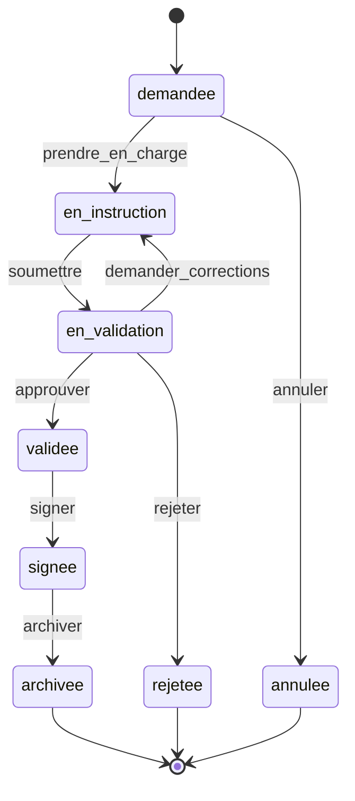

# Workflow d'un acte GestActes

**Propriétaire :** NDOUNGUE ESSOH ABEL THOMAS
**Source de vérité :** table `demandes.statut`
**Miroir :** labels GitHub `statut:*`
**Version :** 2.0

---

## 1. États canoniques

| Code | Libellé UI | Description | Terminal |
|---|---|---|---|
| `demandee` | Demandée | La demande est déposée, pas encore prise en charge. | Non |
| `en_instruction` | En instruction | Un agent rédige le brouillon. | Non |
| `en_validation` | En validation | Une PR est ouverte, un validateur doit statuer. | Non |
| `validee` | Validée | Le validateur a approuvé, la signature reste à faire. | Non |
| `signee` | Signée | La PR est fusionnée, le PDF est en cours de génération. | Non |
| `archivee` | Archivée | Le PDF et le tag existent, l'acte est immuable. | Oui |
| `rejetee` | Rejetée | Le validateur a rejeté avec un motif. | Oui |
| `annulee` | Annulée | Le citoyen a annulé avant la prise en charge. | Oui |

> Les codes sont en `snake_case`, sans accent, sans espace.Les libellés français
> ne servent qu'à l'affichage et aux e-mails.

## 2. Machine à états



## 3. Table des transitions

| ID | Depuis | Action | Vers | Rôles autorisés | Conditions | Effets |
|---|---|---|---|---|---|---|
| T-01 | `demandee` | `prendre_en_charge` | `en_instruction` | Agent | Demande non assignée. | Assigne l'agent, crée la branche, assigne l'Issue, audit, job `github.provision_demande`. |
| T-02 | `demandee` | `annuler` | `annulee` | Citoyen propriétaire | Aucune prise en charge. | Ferme l'Issue, label `statut:annulee`, audit, e-mail. |
| T-03 | `en_instruction` | `soumettre` | `en_validation` | Agent assigné | `acte.json` et `acte.md` existent. | Ouvre la PR, label, reviewers, audit, e-mail. |
| T-04 | `en_validation` | `demander_corrections` | `en_instruction` | Validateur | Commentaire obligatoire. | Revue `REQUEST_CHANGES`, PR conservée, audit, e-mail. |
| T-05 | `en_validation` | `approuver` | `validee` | Validateur | PR ouverte, aucun changement demandé en attente. | Revue `APPROVE`, audit, e-mail. |
| T-06 | `en_validation` | `rejeter` | `rejetee` | Validateur | Commentaire obligatoire. | Commentaire + fermeture PR et Issue, audit, e-mail. |
| T-07 | `validee` | `signer` | `signee` | Validateur | PR ouverte, hash calculable, merge possible. | Écrit `signature.json`, merge, enregistre `merge_commit_sha`, audit, job `pdf.generate`. |
| T-08 | `signee` | `archiver` | `archivee` | Système (worker) | PDF généré, tag posé, copie archive. | Statut final, URL PDF, audit, e-mail. |

## 4. Transitions interdites

Toute transition non listée renvoie `409 CONFLICT` avec le code
`INVALID_TRANSITION`.

Exemples :

- `demandee -> en_validation` : interdit, il faut une prise en charge.
- `en_instruction -> signee` : interdit, il faut une validation.
- `archivee -> en_instruction` : interdit, un acte archivé est immuable.
- `rejetee -> en_validation` : interdit dans le MVP.
- `annulee -> demandee` : interdit.

## 5. Autorisations

| Action | Citoyen | Agent | Validateur | Admin |
|---|---|---|---|---|
| Voir sa demande | Oui, la sienne | Oui, file | Oui, file | Oui |
| Déposer | Oui | Non | Non | Non |
| Annuler | Oui, la sienne, `demandee` | Non | Non | Non |
| Prendre en charge | Non | Oui | Non | Non |
| Modifier le contenu | Non | Oui, assigné | Non | Non |
| Demander un complément | Non | Oui, assigné | Non | Non |
| Soumettre | Non | Oui, assigné | Non | Non |
| Approuver / corriger / rejeter | Non | Non | Oui | Non |
| Signer | Non | Non | Oui | Non |
| Voir l'audit | Non | Non | Non | Oui |
| Voir les stats | Non | Non | Non | Oui |

> L'admin ne signe pas et ne modifie pas les actes : il administre la
> plateforme. Cela évite de mélanger les responsabilités.

## 6. Effets de bord par transition

Chaque transition doit, dans une seule transaction base :

1. Vérifier l'état courant avec `SELECT ... FOR UPDATE` (ou une mise à jour
   conditionnelle `WHERE statut = :attendu`).
2. Vérifier le rôle et l'appartenance.
3. Mettre à jour le statut et les champs associés.
4. Écrire `audit_events`.
5. Écrire `outbox_jobs` pour les effets externes.
6. Créer les notifications internes.
7. Committer.

Les appels GitHub et SMTP ne sont **jamais** faits dans la transaction HTTP.
Ils sont faits par le worker.

## 7. Champs de la demande liés au workflow

| Champ | Utilisé par | Rôle |
|---|---|---|
| `statut` | Toutes | État courant. |
| `assigned_agent_id` | T-01, T-03 | Agent responsable. |
| `assigned_validator_id` | T-04, T-05, T-06, T-07 | Dernier validateur ayant statué. |
| `complement_attendu` | Complément | Booléen, la demande reste `en_instruction`. |
| `complement_message` | Complément | Message au citoyen. |
| `rejection_reason` | T-06 | Motif obligatoire. |
| `signature_sha256` | T-07 | Hash du manifeste. |
| `signature_manifest` | T-07 | Contenu de `signature.json`. |
| `signed_by_id` | T-07 | Validateur signataire. |
| `signed_at` | T-07 | Horodatage UTC. |
| `merge_commit_sha` | T-07 | SHA du merge GitHub. |
| `tag_name` | T-08 | Tag d'archivage. |
| `archived_at` | T-08 | Date d'archivage. |

## 8. Complément d'information

Le complément ne crée pas un nouvel état pour rester simple :

- `en_instruction` + `complement_attendu = true`.
- L'agent saisit un message.
- Le citoyen reçoit une notification et peut ajouter une pièce ou répondre.
- L'agent remet `complement_attendu = false` après réception.
- La soumission reste possible même si le complément est encore marqué, mais
  l'UI affiche un avertissement.

## 9. Labels GitHub

| Statut | Label | Couleur |
|---|---|---|
| `demandee` | `statut:demandee` | `#B7791F` |
| `en_instruction` | `statut:en-instruction` | `#4A6FA5` |
| `en_validation` | `statut:en-validation` | `#7C5CBF` |
| `validee` | `statut:validee` | `#3F7D5A` |
| `signee` | `statut:signee` | `#2F6F68` |
| `archivee` | `statut:archivee` | `#4B5563` |
| `rejetee` | `statut:rejetee` | `#B45151` |
| `annulee` | `statut:annulee` | `#6B7280` |
| Type | `type:attestation-residence` | `#C9A66B` |
| Type | `type:extrait-naissance` | `#C9A66B` |
| Type | `type:autorisation-administrative` | `#C9A66B` |
| Complément | `complement:attendu` | `#B7791F` |

Le worker ajoute le nouveau label et retire l'ancien. En cas d'échec, le label
est resynchronisé par le job de réconciliation.

## 10. Messages de commit

Format :

```text
[ACTE-<année>-<numéro>] <étape>: <description courte>
```

Exemples :

```text
[ACTE-2026-00042] instruction: correction de l'adresse
[ACTE-2026-00042] instruction: ajout de la pièce justificative
[ACTE-2026-00042] signature: validation de Eunice NZEUTEM
[ACTE-2026-00042] archive: génération du PDF et du tag
```

## 11. Tests obligatoires du workflow

| Test | Attendu |
|---|---|
| `demandee -> prendre_en_charge` par un agent | 200, statut `en_instruction`. |
| `demandee -> prendre_en_charge` par un citoyen | 403. |
| `en_instruction -> soumettre` sans contenu | 409. |
| `en_validation -> approuver` par un agent | 403. |
| `en_validation -> rejeter` sans commentaire | 422. |
| `validee -> signer` par un validateur | 200, `signature.json` créé, merge. |
| `archivee -> modifier` | 409. |
| Double clic sur `soumettre` | Une seule PR, idempotence. |
| Deux agents prennent en charge en même temps | Un seul gagne, l'autre reçoit 409. |
